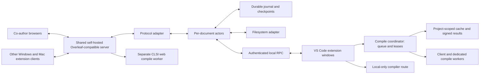

# Collaborative LaTeX — Architecture and Delivery Plan

Design revision: 10 October 2026.

## 1. Scope and delivery contract

This project is proprietary. Third-party components retain their own licenses; THIRD_PARTY_NOTICES.md and a dependency inventory are maintained.

The product is a native Windows/macOS VS Code extension and an independent self-hosted Overleaf CE+ collaboration service. Collaborators use VS Code or the unchanged CE+ web UI. The Premium account is never the hub, credential source or runtime dependency. The extension reproduces practical Overleaf features through native VS Code APIs, LaTeX Workshop and existing extensions. Server patches, web UI changes and upstream forks are forbidden; unsupported upstream behavior has a recorded probe result and a visible fallback.

### Required behavior and boundaries

Install one matching VSIX without developer tools. Link a project to a local folder using individual authentication. Preserve native `.tex`/`.bib` editing, review identities, tracked deletions, authorship, offline intent, unsaved buffers and crash recovery. Distinguish pending, durably journaled, remotely confirmed, disk-saved, conflicted and unsupported states. Each client engine exits after its final lease; the shared service remains independent. Source Git backup is not the live sync or review channel.

| Capability | Delivery requirement |
|---|---|
| Text and review | Live writes only for formats passing the fidelity gates; unsupported formats remain read-only |
| Bibliography, figures, plot data and styles | Exact source preservation; two-way binary replacement only after conditional-write proof, otherwise visible one-way mirroring |
| Local create/rename/move/delete/upload | Explicit extension commands using stable entity IDs and the mutation gate; never infer a move/delete from a missing local file |
| Shared compilation | Per-job placement across compatible workers, local fallback and separate CLSI for web users; sync services never execute TeX |
| Platforms | Windows x64, Apple Silicon and Intel macOS; Windows ARM64 is outside the first release |
| Remote extension hosts | Remote SSH, WSL, containers and browser VS Code outside first release; detect unsupported hosts |
| Sharing | Web UI owns membership and permission management; extension opens the project in browser |

### Feature parity matrix

Web entries are CE+ capabilities to probe on the pinned build, not instructions to modify the web UI. Unsupported capabilities are labelled in the extension.

| Overleaf feature | Web (CE+) | VS Code | Phase | Gate |
|---|---|---|---|---|
| Concurrent editing/review | Unchanged editor and review UI | Native buffers, comments and tracked changes | R1/R4 | R1-OT, R1-REVIEW, R4-EDITOR, R4-REVIEW |
| Compile/Auto compile | Separate CLSI, native web trigger | Save/idle/manual/off, cancel-and-restart | R5/R6 | R5-COMPILE, R5-COEDIT-COMPILE, R6-COMPILE-LOAD |
| Compiler/main file/spell language | Native project settings | Two-way settings adapter, local fallback when unavailable | R5 | R5-COMPILE |
| Error/warning/typesetting list/log | Existing web panels | Click-to-jump diagnostics and raw logs | R5 | R5-COMPILE |
| PDF/navigation/download | Existing PDF panel | PDF panel, export and two-way SyncTeX | R5 | R5-SYNCTEX |
| Source ZIP and word count | Existing commands when available | Safe ZIP export and project word count | R5 | R5-COMPILE |
| Completion/outline/folding/search | Existing editor | LaTeX Workshop and native APIs | R4 | R4-EDITOR |
| Multilingual spelling/keybindings | Native supported settings | Existing spell-check, Vim/Emacs extensions; optional symbol palette | R4 | R4-EDITOR |
| People/carets/selections | Probe clientTracking rendering | Decorations, people panel, badges and follow | R4 | R4-PRESENCE |
| Project chat | Probe existing chat | Project chat panel | R4 | R4-CHAT |
| History/labels/restore | Probe existing history | View, label and confirmed restore command | R5 | R5-HISTORY |
| File tree and uploads | Existing project tree | Explicit ID-based commands and recoverable conflicts | R4/R5 | R4-FILETREE, R5-ASSETS |
| Sharing and permissions | Native web management | Open project in browser | R4 | R4-EDITOR |

### Verification principles

Gate evidence uses the exact upstream implementation or real server state, native installed hosts and independently inspected outputs. Simulators and mocks support coverage but are not the sole oracle. Saved commands, hashes, environments and logs support every pass; unavailable checks block their gate. Visible text, transport acknowledgements and successful builds are distinct from review fidelity, durable persistence and correct rendered content. Unknown capabilities remain held or visibly limited. The ranked gate index is the sole definition of acceptance criteria; other sections describe implementation and reference gate IDs.

## 2. Corrections to the supplied draft

| Draft assumption | Revised design |
|---|---|
| Every window's `deactivate()` shuts down the engine | A window releases its own lease. The shared engine exits only after the last lease expires. |
| The original parent dying always stops the shared engine | Parent death is relevant during bootstrap only. Once shared, authenticated client leases determine lifetime. |
| Uninstall/deactivate always runs cleanup | Treat cleanup callbacks as best effort. Process termination tests must exercise paths without them. |
| A re-hash before rename prevents external-write loss | It leaves a time-of-check/time-of-use race. Preserve recovery copies and define the limits of uncoordinated disk writers. |
| Every replica always hashes to the optimistic local text | Confirmed server text can differ while writes are pending; dirty disk can differ legitimately. Check version-aware projections. |
| Socket acknowledgement proves persistence | Separate transport acknowledgement, authoritative application evidence, and durable local receipt. |
| Counts alone prove comment preservation | Compare stable IDs, anchors, attribution, payloads, and legitimate lifecycle events. Counts may legitimately change. |
| Rejecting a tracked change is range-only | Rejection may change visible text. Replay actual server semantics per change type. |
| Relay between overleaf.com and a local CEP project | Removed after the user's topology decision. All collaborators use one shared self-hosted hub. |
| A loopback proxy can authenticate by Referer/Origin | These are defense-in-depth checks, not bearer credentials. Every privileged HTTP and WebSocket request needs authenticated authority. |
| 120 edits/min is a safe breaker with 200 ms batching | Continuous batches can reach 300/min. Separate throughput shaping from error and loop detection. |
| Ten offline minutes implies marker-free reconnect | Retention depends on server history availability and edit volume, not elapsed time alone. |
| Git backup preserves a complete review state | Treat Git as source-file backup; record review metadata separately and verify what can actually be restored. |
| UUID build paths necessarily produce empty VSIX files | Treat this as an unverified environment-specific observation. Inspect and test artifacts regardless of path. |
| Delete old extension folders after each milestone | Use supported install/uninstall flows in disposable profiles; retain a known-good rollback artifact. |

Overleaf documents that Git pushes can lose or displace review information. This supports avoiding Git as the live write channel, without proving that every whole-file operation always destroys every comment. [Overleaf Git documentation](https://www.overleaf.com/learn/how-to/Git_integration)

The jujuleaf README describes tracked suggestions, confirmed-write handling, retry deduplication and both OT formats. Compare a pinned revision technically against reproducible fixtures. [jujuleaf repository](https://github.com/CsomePro/jujuleaf)

## 3. Evidence and protocol discovery

### Evidence ledger

Maintain `docs/protocol-evidence.md` and machine-readable `test/fixtures/protocol/capabilities.json`. Each entry records:

- Contract ID and exact claim.
- Endpoint, account role, document format, connection epoch, and observation date.
- Pinned source commit and file/line reference where available.
- Sanitized trace ID and executable regression test ID.
- Classification: proposed, source-observed, staging-observed, production-observed, contradicted, or unsupported.
- Failure behavior and the capability disabled if the observation no longer holds.

Pin the actual self-hosted server image by digest and source revision. No cloud account is needed for the protocol gates.

The public `WebsocketController.js` retrieved during this review distinguishes history-format line handling from legacy encoded lines, exposes an additional `joinDoc` capability bag, and describes project-room operation broadcasts with a no-op `leaveDoc`. These are concrete reasons to stop treating the original P5/P6/P10 assumptions as universal. [Overleaf controller source](https://raw.githubusercontent.com/overleaf/overleaf/main/services/real-time/app/js/WebsocketController.js)

### Required probe groups

| IDs from original | What must actually be established |
|---|---|
| P1–P4 | Self-hosted handshake, redirects, cookie scope, frame dialect, heartbeat, project join shape, connection identity; cloud GCLB assumptions are irrelevant unless observed on this deployment |
| P5–P6 | Full join versus catch-up, version meaning, encoding per format/field, snapshot ordering relative to broadcasts |
| P7–P12 | Request schema, application confirmation, correlation, concurrent same-account clients, deduplication scope and lifetime |
| P13 | Tracking state scope: account, project, document, browser session; whether another client's toggle is observable |
| P14 | Entity event schemas, duplicate/reordered events, delete/move semantics, stable IDs |
| P15–P16 | Exact review mutations, permissions, idempotency, visibility, text and metadata version changes |
| P17–P18 | Format per document, history representation, Unicode support; no assumed BMP-only limitation |
| P19 | REST schemas, authentication, CSRF rotation, redirects and error responses |
| P20–P21 | Subscription strategy, event completeness, rate/backpressure behavior, practical scale |
| P22 | Self-hosted authentication and, separately, optional browser embedding on the actual VS Code build |

| Additional probe | Contract and fallback |
|---|---|
| P-PRESENCE | clientTracking lists/positions/updates/disconnects; coordinate units, distinct client IDs, extension/web caret rendering and mirror-mode presence |
| P-CHAT | Read/send/event ordering, authorship, permissions and ambiguous-send behavior; unsupported API opens web chat |
| P-HISTORY | Version listing, label creation and restore semantics, authorization and post-restore generation; unavailable actions open web UI |
| P-SETTINGS | Compiler, root file and spell language read/write plus concurrent updates; unsupported fields stay local with a visible limitation |
| P-FILETREE | Explicit create/rename/move/delete/upload identities, idempotence and conflict semantics; unsupported operations remain held |
| P-CLSI-HOST | Separate-host compile routing by configuration only, authentication and sync-host load isolation |
| P-CLSI-MULTI | Multiple instances, routing affinity, cancel/status/results and queue compatibility; fallback to one separate CLSI |
| P-CLSI-SHARING | Whether one user's compile refreshes another user's PDF; otherwise each web user's own Auto compile controls freshness |

Add explicit probes for: permission revocation mid-edit; server restart; duplicate and delayed confirmations; accepted write followed by lost connection; same account in two browser tabs; tracked deletion rejection; orphaned comment anchor; changed root document; event subscription gaps.

Discovery has two distinct tracks:

1. Read-only inventory of authorized projects: formats, roles, root, compiler, size, review counts, assets.
2. Mutation experiments only in disposable projects: comments, review changes, concurrency, and deliberately broken connections.

Use scripted disposable-project experiments with expected preconditions and independently observed outcomes.

### Capability gate

Live writes require proven encoding, apply/transform semantics, version interpretation, authoritative confirmation, ambiguity recovery, and metadata preservation for the specific format. Review mutations and server deployment recovery have separate gates. Unknown wire changes pause the affected capability and preserve pending work.

Joining every document is a candidate strategy, not a product requirement. What is required is complete event coverage and the ability to validate and mutate a document safely. Record whether lazy hydration with project events is sufficient.

## 4. Architecture and ownership

The hub is authoritative for confirmed remote state. Local durable edits are authoritative evidence of outstanding user intent. Neither is allowed to erase the other merely because synchronization resumes.

### Components and intended files

| Area | Intended files | Responsibility |
|---|---|---|
| Extension activation | `src/extension.ts`, `src/lifecycle.ts` | Trust/platform checks, connection, lease, restart policy |
| Configuration | `src/config.ts`, `package.json` | Schema, scope, validation, resolved settings |
| Native channel | `src/documents.ts`, `src/editBridge.ts` | Buffer revisions, remote patches, echo correlation, ownership |
| UI | `src/views/*`, `src/review/*` | Projects, comments, changes, conflict resolution, status |
| Compilation | `src/compile/*` | Session-aware placement, snapshots, TeX discovery/install, recipes, cache and artifact freshness |
| Coordinator | `coordinator/*` | Authenticated job queue, leases, fairness, member/package registry and cache index; no compilation |
| Worker | `worker/*`, `engine/crates/platform/*` | Restricted execution, CPU accounting, package admission and signed results |
| Protocol | `engine/crates/proto/*` | Wire framing, REST, auth, profiles, capability checks |
| OT adapters | `engine/crates/ot/*` | Format-specific apply/transform/compose and review semantics |
| Persistence | `engine/crates/store/*` | SQLite through `rusqlite`; transactions, durable outbox, migrations, recovery bundles |
| Merge | `engine/crates/merge/*` | Fallback three-way merge and revision-bound resolution |
| Runtime | `engine/crates/engine/*` | Actors, queues, leases, scheduling and disk adapters |
| Platform | `engine/crates/platform/*` | macOS/Windows IPC, locks, process supervision and file replacement |
| Server deployment | `server/*`, `docs/server-operations.md` | Pinned server deployment, TLS, backups, health checks, upgrade/restore scripts |
| Independent tests | `engine/crates/fakeleaf/*`, `tools/refgen/*` | Fault injection and pinned reference outputs |
| Host/package tests | `test/host/*`, `test/package/*` | Real installed VSIX behavior and artifact inspection |
| Stress evidence | `ols_stress/*`, `docs/validation/*` | Seeds, minimized failures, reports and release matrix |

Use the stack selected in section 20: TypeScript for the extension, Rust/Tokio for the local engine, and the existing CE+ server implementation. Choose exact package versions after the compatibility spikes; pin toolchains and lockfiles. Do not add every proposed test or runtime dependency before proving a need. Benchmark release settings rather than assuming maximum LTO is always best.

Maintain a provenance record for vendored code and reference fixtures alongside the dependency inventory.

### Local RPC contract

Use versioned JSON-RPC with bounded frames and request deadlines over authenticated local IPC: a Unix-domain socket on macOS and a named pipe with a current-user access policy on Windows. Bootstrap may use stdio to return the connection information; normal clients use the same RPC protocol through a platform transport abstraction.

Required methods include `hello`, `acquireLease`, `renewLease`, `releaseLease`, `openDocument`, `submitLocalEdits`, `ackRemotePatch`, `closeDocument`, `setMode`, `resolveConflict`, read-only status/snapshot queries, session-mode selection, presence, compile requests/cancellation and member configuration (including reserved `compile.contribute`).

Messages carry engine epoch, client ID, document ID, ownership generation, local sequence, expected buffer revision, and request ID where applicable. Unknown major RPC versions fail clearly. Old ownership generations cannot submit writes. Bound event queues; a slow client must rehydrate rather than lose arbitrary patches.

## 5. Shared engine lifecycle

1. Use a stable, per-user runtime identity independent of the configurable state directory. Restrict Unix permissions or Windows ACLs; authenticate peers/session capability and validate paths.
2. Acquire an OS-held exclusive lock. A lock file's existence or stored PID is not proof of a live owner.
3. Spawn races resolve through the OS lock or named mutex; losing starters connect to the winner. Remove stale Unix sockets only while holding the lock. Windows pipe creation and mutex ownership require their own tested implementation.
4. Every enabled extension host registers a lease. Proposed values: renew every 2 seconds, expire after 8 seconds, stop after a further 5-second idle grace.
5. Closing one window releases its lease only. If another remains, the engine and its projects stay alive.
6. An ordinary `deactivate()` does not send global shutdown or kill the shared process.
7. On final lease expiry, stop accepting new work, persist pending state, close connections, stop owned compiler/proxy children, and exit within the tested deadline.
8. After sleep/wake, reconnect and validate epochs and state before sends; clocks used for lease timing are monotonic.
9. Conflicting `dataDir` or engine-version requests must produce a visible resolution state, not a second engine against the same project. Defer incompatible upgrades until leases drain.

The target is no engine process within 15 seconds of the final client disappearing on an awake, schedulable machine on either OS. Test native forced process termination on Windows and SIGKILL on macOS. A suspended system or unkillable process cannot be covered by an absolute wall-clock promise.

The shared server is never tied to a client's lease or uninstall lifecycle. Closing the host administrator's VS Code must not disconnect collaborators. Disposable development servers have a separate explicit start/stop lifecycle; never stop unrelated containers or delete volumes.

## 6. Document state and durable operations

### Persistent records

For each document retain:

- Endpoint/account/project/document IDs, entity path mapping, format and capability fingerprint.
- Confirmed remote text and review state `B`, plus remote version `v` and metadata observation stamp.
- At most one submitted unresolved wire operation `I` per server connection/document.
- Ordered local pending operations `Q`, with stable local operation IDs and tracking decisions.
- Optimistic local state `L`, buffer revision, ownership generation, disk baseline and last-write receipt.
- Connection/source identity, submission evidence, confirmation evidence and ambiguity status.
- Conflict/recovery records and the exact bases needed to reconcile them.

For supported text operations:

`L = apply(apply(B, I), Q)`

Here `I` is empty when none exists. Review state must use the format adapter's corresponding projection, not text equality. Each machine has its own projection against the same shared server state; there is no second CEP replica to relay into.

### Edit lifecycle

| State | Meaning | Allowed next action |
|---|---|---|
| Captured | Extension saw a buffer event | Submit to journal; not yet labelled durable |
| Durable | Journal transaction committed | Acknowledge local durability and schedule |
| Prepared | Preconditions and wire representation recorded | Send if runtime permissions/capabilities still permit |
| Submitted | Socket transmission attempted | Await application evidence; timeout may become ambiguous |
| Transport-acknowledged | Server queued/received request | Continue waiting; do not mark synchronized |
| Confirmed | Authoritative application identified | Atomically advance base and remove pending receipt |
| Ambiguous | Submission may have committed | Recover evidence; never blindly resend |
| Rejected/held | Cannot safely apply | Preserve intent and show actionable state |

Persist operation intent and its source/base/version BEFORE sending. Persist confirmation and checkpoint advancement in one transaction. A crash between socket send and receipt storage is expected and tested.

Implement this journal in bundled SQLite through `rusqlite`, owned by a dedicated database thread behind a bounded request queue. The actor cannot acknowledge durability or send dependent work until that thread reports a successful transaction commit. Section 20 defines durability settings, backup behavior and dependency validation; `redb` is an evaluated alternative, not the default store.

If the engine cannot commit the journal, stop remote sends and stop claiming local durability. The editor may remain editable with a visible warning. Storage exhaustion must not discard the oldest unconfirmed operation to make room.

### Remote operation processing

1. Validate document, format, connection epoch, and version interpretation.
2. Reject or recover gaps; do not guess missing edits from visible text.
3. Transform the remote operation against the in-flight operation, then pending operations, obtaining both transformed local operations and the remote projection for `L`.
4. Update confirmed base, projected local state, review state, and pending queue atomically.
5. Emit a revision-bound patch to the local editor/disk destination. The server broadcasts to other collaborators through its own protocol.
6. Wait for destination acknowledgement or mark that replica stale.

Metadata-only events follow the same ordering discipline but need not advance text versions. If the server lacks one joint revision for text and review state, record separate stamps and establish a barrier or repeat read until a consistent observation is obtained.

### Ambiguous outcome recovery

After disconnect or crash, retain the original source identity, base version, exact submitted operation and deduplication evidence. Use observed catch-up history and the proven server deduplication mechanism to establish whether it committed. Changed reconnect identities and expired deduplication windows must be covered.

Text-hash equality alone is not proof: another client may have made the same insertion, or later reverted it. If the outcome cannot be established, hold the operation and present the local intent alongside the current hub state. Do not promise exactly-once remote effects without server evidence.

## 7. OT, Unicode, review preservation, and tracking

### Text contract

- Make UTF-16 offsets, UTF-8 byte offsets, and editor line/character positions distinct types.
- Validate conversion boundaries; test supplementary characters, Turkish text, combining marks, zero-width joiners, and empty documents.
- Preserve normalization; never silently convert NFC/NFD.
- Keep disk encoding, BOM, line endings, and final newline policy explicit. Remote logical text may not preserve original CRLF bytes; do not promise both universal byte equality and normalization.
- Confirm how incoming multi-change editor transactions are indexed. Convert against their shared prior revision and test multi-cursor/paste/IME events.
- Prefer exact editor edits. When diffing disk changes, use a bounded algorithm that retains unchanged spans; minimum edit count alone is not metadata safety.
- Use Ropey for the engine's editable text representation, `imara-diff` for bounded recovery/disk diffs and `diffy` for fallback three-way text merging. These packages do not implement Overleaf review semantics; the format adapter and independent oracle remain required. See section 20 for indexing and cancellation constraints.
- Define simultaneous-insert tie breaking from the protocol oracle. Compose only operations whose tracking/author semantics permit composition.
- Reject malformed positions/deletions before serialization. Never split surrogate pairs to satisfy an update-size limit.

### Review contract

Preserve stable thread/change IDs, message bodies, resolution state, author IDs, anchors, tracked insertion content, hidden tracked deletion content, and the protocol's legitimate split/merge behavior. Byte-identical metadata is not required where the server legitimately transforms it; semantic equivalence is.

An edit inside a tracked insertion may legitimately alter that change. Deleting a comment's entire anchor may legitimately collapse it. Tests must specify the expected server behavior instead of banning every range-count reduction.

Run prediction before sending; use a version-consistent authoritative refresh after risky range interactions. A post-write check detects damage after it happened and cannot be advertised as prevention. Novel unsupported range interactions are held before sending until the adapter has coverage.

Do not reconstruct hidden deletion state from visible text. Never silently relabel co-author changes as the extension account's changes.

### Tracking policy

Each locally captured edit records its tracking policy and known toggle observation. Reconnect must not retroactively change tracking decisions for already journaled edits.

For `followBrowser`, discover the actual scope and event ordering of the browser setting. If it is unobservable or stale, mark tracking state unknown and hold outbound edits that depend on it. “Exactly follows” is a release claim only for behavior demonstrated by the probe. `always` and `never` remain explicit alternatives within server permissions.

## 8. Native editor channel and disk coordination

VS Code document-change events also include non-content state changes, and edit/undo behavior needs host-level validation. Use the API as an observable event stream, with explicit revision and patch acknowledgements. [VS Code API reference](https://code.visualstudio.com/api/references/vscode-api)

### Open/handoff protocol

1. Capture the current buffer content, editor version, dirty state, disk snapshot and engine baseline before writing anything.
2. Request a document ownership generation. Serialize competing requests from other windows.
3. Reconcile buffer, disk and engine state using their known bases. Preserve every divergent candidate.
4. Apply only a patch that still matches the expected buffer revision. If the revision changes, rebase/retry rather than overwrite.
5. Acknowledge the actual resulting text hash and editor version. Grant streaming ownership once the handshake completes.

A second window viewing the same file is an observer until an explicit handoff. If it is edited despite that status, capture and hold those edits; ordinary file editors cannot be assumed universally read-only. Initial v1 need not implement simultaneous multi-window local OT, but must preserve both buffers.

### Remote patch protocol

- Each patch has an application ID, expected revision and expected old spans.
- Suppress only the exact resulting change transaction attributable to that patch. A global “ignore next change” flag can swallow user typing.
- Check `workspace.applyEdit` results and the observed resulting document, including races during the call. A pre-check alone is not compare-and-swap.
- Keep user edits and remote events ordered while patch application is outstanding.
- Undo/redo, revert, save-as, multi-cursor edits and format-on-save are explicit test cases. Do not claim collaborative undo correctness until demonstrated in the real host.

### Unsaved buffers

Live typing may reach the hub before local Save. Show remote confirmation and local dirty state separately. Compilation uses an immutable snapshot of the requested buffer/source generation; label its relationship to saved disk and confirmed hub state.

If a user closes and discards an unsaved buffer that has already synchronized, define the action as a new local change requiring reconciliation; it is not a silent rollback of the hub. Preserve a recovery version and explain the resulting state in the close/reopen workflow.

On extension-host crash, journaled unsaved edits survive in the engine store. On restart, reconcile them with recovered VS Code buffers and disk. Never assume VS Code alone will retain every unsaved byte.

### Closed-file disk writes

Use same-directory temporary files, explicit flushes, atomic replacement where supported, directory durability checks, and a durable write-intent/receipt. Exclude build output, trash, temporary files, and internal state from upload candidates.

External programs can write between any pre-write check and replacement. Ordinary files do not provide a universal compare-and-swap transaction against arbitrary editors. Test the narrow race; preserve observed competing content, pause on uncertainty, and document the supported single-writer boundary. If zero loss against arbitrary uncoordinated disk writers is mandatory, that is an unresolved architecture requirement, not something a re-hash fixes.

With an open dirty buffer, an external disk change causes a three-way reconciliation prompt and preserved copies. Do not unconditionally reload or save over the disk candidate.

## 9. Shared server, compile services and identity

### Topology and profiles

Use the unmodified pinned CE+ image and its compatible Toolkit, MongoDB and Redis deployment. The web UI remains CE+. Sync services handle documents, review, membership and file storage; they do not execute TeX. A separate CLSI compile worker serves web PDFs, and a separate coordinator schedules extension compile jobs without compiling itself. Authenticate service-to-service calls and keep internal databases, worker control ports and storage private.

Stage D is ephemeral and synthetic: prefer a remote Linux runner when available; local Docker Desktop is the fallback. The test runner creates uniquely owned resources, captures sanitized evidence, then removes its containers/data on success, failure or timeout. A five-minute inactivity watchdog and a recorded crash-cleanup manifest cover interrupted runners. Preserve evidence in durable scratch storage after every merge; never prune unrelated containers or volumes.

| Stage D profile | Default and limits | Purpose |
|---|---|---|
| fast | Default quick run; relaxed but finite per-service caps, initially at most 4 CPUs / 8 GiB aggregate and reduced when host headroom is lower | Rapid synthetic development, no compile services |
| strict-limits | Explicit 2 CPUs total, 3–4 GiB aggregate with measured per-service allocations | S-D-LIMITS |
| compile | Separate worker/coordinator resources and caps; compile jobs never enter sync containers | CLSI/coordinator and local-worker integration |
| heavy | Explicit opt-in on a dedicated runner or an idle local machine; preflight warning | Scale, chaos and soak workloads |

Both fast and strict runs record CPU, memory, disk and foreground responsiveness. Strict tests compare repeated unloaded/loaded foreground-operation p95 with a ≤10% regression margin; stop, tighten or relocate workloads when limits fail. Include host overhead. Define enforced data/log quotas and bounded image storage before starting; use quota-backed storage where the default filesystem cannot enforce the configured limit. Compile-profile resources have their own budget. Pin images by digest, never auto-update or patch them. Gate: R0-SERVER-DEV.

Stage N runs on a dedicated always-on Linux host. Size sync services, coordinator storage and compile workers independently; administrators supply the deployment values. HTTPS fronts the intended endpoints; databases remain private. Use individual accounts and least-privilege roles. Daily backups include source, files, memberships, review/history state and configuration; measure recovery time and restore into isolation. Daily backup alone permits up to 24 hours of unbacked-up state. Manual updates stage, back up, test, apply and retain rollback; reinstall TeX packages when a worker image update discards them. Gates: R6-EXPOSURE, R6-BACKUP.

### Web compilation without server patches

Probe separate-host CLSI routing through configuration, multiple CLSI instances, session/build isolation, and whether one user's compile refreshes another web user's PDF. Default web behavior is per-user compilation and each user's own Auto compile setting; never promise refresh from VS Code activity without probe evidence. If multiple instances are unsupported, use one CLSI on a separate host, concurrency 1 by default (maximum 2 after load measurement), latest-wins pending requests per project, per-project rate limits, timeout and build-directory cleanup.

A configuration-compatible fronting adapter may provide queuing only if the observed CLSI contract allows it without altering CE+ or CLSI source. Preserve requester/build identity: a superseded request must receive a valid cancellation/result response, not another user's PDF. If a required routing/queue behavior is unavailable, expose the precise limitation and keep that feature unavailable; never move compile work into sync services. [CLSI interface](https://github.com/overleaf/overleaf/blob/main/services/clsi/README.md)

For the small trusted-team deployment, default to a warm sandbox with isolated job directories and cleanup. Per-compile containers provide stronger separation at startup cost and need a controlled Docker interface; never give a TeX job Docker socket access. A warm worker reduces startup overhead but has weaker between-job isolation, so it must remain a restricted dedicated service without unrelated secrets. Measure both modes. Gates: R5-COMPILE-TRUST, R6-COMPILE-LOAD.

### Deployable bundle

The `server/` bundle includes pinned sync/CLSI configuration, coordinator deployment, readiness and shutdown commands, HTTPS/private worker routing, rate/size limits, backups, restore, upgrade/rollback and incident procedures. The coordinator maintains queue, leases, member registry and cache index; cache bytes live on authorized worker/object storage or requester replicas, not in its scheduler database.

Compile-worker setup installs the full TeX Live scheme once with `tlmgr install scheme-full`, recording TeX Live version and worker image digest. Budget roughly 5–7 GB initially and measure the actual release footprint/headroom rather than treating that range as a cap. Setup/runbooks reinstall the scheme after upgrades as needed. No web-user package prompt; a remaining failure says “package missing on the server, notify the administrator”. Gates: R6-EXPOSURE, R6-COMPILE-LOAD.

### Authentication, authorization and presence transport

Use the pinned server's verified login/session flow. Each person has separate credentials in SecretStorage scoped to normalized origin and account. Reject cross-origin forwarding; enforce membership and current permissions on each privileged request. Logout, expiry and revocation preserve unsent local work. TLS and origin checks protect production channels; loopback synthetic tests use synthetic credentials only. Gates: R0-CRED, R2-REVOKE.

Probe P-PRESENCE for clientTracking connected-user lists, position/client-update/disconnect events. Convert observed row/column units to checked UTF-16 offsets, with emoji, Turkish and combining-mark fixtures. Transform cursors and selections through every applied OT operation, including optimistic local edits and rebases. Distinguish the same account on two client IDs. Remove presences on disconnect or a 15-second default stale timeout, with heartbeat/timeout tuned to observed server semantics.

Render remote carets/selections with `TextEditorDecorationType`, user color/name; provide “People in this file”, click-to-jump, optional follow, `FileDecorationProvider` badges and “N people in this file” status. Coalesce local selection events on a 50 ms default throttle (50–100 ms tuning range) in the lowest-priority queue. Presence is ephemeral and allowed in mirror mode; it cannot delay journal/text work or establish edit durability. Verify extension-to-web and web-to-extension rendering; record unsupported CE+ rendering without patching. Gate: R4-PRESENCE.

## 10. Offline work, conflicts, entities, and migration

### Reconnect procedure

1. Authenticate again if required and obtain a new connection epoch.
2. Recheck permissions and protocol capabilities.
3. Resolve any previously submitted ambiguous operation before submitting later dependent work.
4. Request catch-up operations from the recorded confirmed version.
5. If a continuous valid history exists, transform pending edits and review metadata through it.
6. If history is unavailable, preserve the local candidate and request a complete authoritative snapshot.
7. Perform three-way reconciliation from the actual saved common base. Text merging does not automatically establish review-state safety; range interactions may still require a hold.
8. Apply or present the result, validate it, and resume only the capabilities whose preconditions are satisfied.

Finite retention means no fixed number of offline minutes guarantees automatic merge. An OT merge can converge yet produce semantically awkward text; the UI must permit review without pretending convergence proves intent.

### Conflict representation

Keep `base`, `local`, `remote`, their revisions/hashes and the merge result in a durable conflict record. The local resolution file may contain tagged diff3 markers, but the upload barrier is the conflict state itself. Deleting marker text alone never bypasses validation.

Continue receiving remote updates while a conflict is open; preserve the original remote snapshot as the resolution base and accumulate subsequent changes. When the user saves a resolution, rebase it against the latest remote state and present any new overlap. Do not freeze or roll back the shared server.

Use extension-owned conflict commands unless the built-in merge UI demonstrably supports the chosen marker syntax. Literal `=======` or marker-like LaTeX content must not accidentally resolve or upload a conflict.

### Entity and asset rules

- Key by stable entity ID, not filename. Validate every remote path under the configured project root.
- Reject traversal, unsafe symlinks/reparse points, reserved Windows names and platform-colliding paths. Never silently rename a LaTeX input without accounting for its references.
- A remote rename/move must carry open buffers and local journal mappings forward without treating it as delete-and-create.
- A remote deletion with pending local edits creates an explicit delete/edit conflict and retains a recovery copy.
- Remote deletions without local divergence move local content to recoverable trash according to retention policy.
- Mirror supported assets after import; enable the reverse direction only after R5 proves conditional replacement. Capture stable file candidates, stream with bounded memory, verify byte counts and SHA-256, and atomically install verified downloads. Preserve originals on interrupted writes or Windows locks.
- Journal asset transfers separately from text OT, retaining entity identity, base version/hash, candidate hash, transfer state and authoritative confirmation. Reconcile ambiguous upload responses before retrying; preserve offline candidates across crashes.
- Require proven server-enforced conditional replacement or equivalent serialization. A client hash check followed by unconditional upload does not prevent races. If unavailable in the unmodified upstream server, keep uploads disabled and provide one-way mirroring with a visible limitation; server patches/forks are outside this revision.
- Concurrent divergent replacements create durable conflicts retaining both complete candidates and their base identity. Never put text conflict markers into binaries or silently select a winner.
- Provide explicit add/import for new bibliography, figure, plot/data and supporting source files, with validated paths, collision checks and idempotent creation/reconciliation. A watcher must not automatically upload every new file.
- Local create/rename/move/delete/upload are explicit extension commands, checked against stable entity IDs, current mode/permission and observed server revision. Preserve delete/edit and rename/edit conflicts, including open buffers and recovery copies. Missing files or generic watcher events never trigger inferred server deletes/moves. Gate: R4-FILETREE.

### Moving existing projects off overleaf.com

The selected deployment is independent. Users remaining on overleaf.com will not see edits made on the new server. Invite them to the new URL or extension project instead.

Source ZIP/Git import preserves source files while leaving original projects untouched. Default migration imports a copy and records unavailable review/history/identity fields; it never implies metadata-preserving migration. No automatic Premium-account scraping or synchronization.

## 11. Review UI, settings, and operational behavior

### Review transactions

Comments and changes are first-class state, not decorations inferred from diffs. Render hub IDs and permissions; refresh after authoritative review events. Show multiline tracked deletions in a readable review panel if decorations cannot represent them faithfully.

Creating a comment may require both anchor creation and message submission. Model this as a resumable operation with recorded steps, correlation IDs and recovery behavior. A timeout must not create a second thread on retry. Apply the same principle to replies and accept/reject commands whose response is lost.

Every mutation validates the current target ID, authorization and revision. Two people resolving or accepting the same item must result in an intelligible already-applied/stale result. Rejecting tracked insertion/deletion must match the server's text transformation, not an invented inverse diff.

### Startup choice for every run

A run is one VS Code workspace/window extension-host session, including window reload. At activation, show **Local only** or **Connect to server**. Remember only the highlighted preference; require an explicit choice each run. Until selection, editing remains usable locally and no collaboration, presence, coordinator or worker-registration connection starts. Cancellation keeps Local only. Opening another document does not repeat the choice. TeX downloads still follow their separate installation policy.

Local only works for unlinked ordinary LaTeX folders and previously linked copies: edit, save, preview, compile and use locally retained results without contacting the server or pool. Do not join projects, publish presence, fetch cache objects, upload edits or register as a worker. Effective compile placement is local/cache or off, regardless of saved auto/shared/server preference. Existing remote metadata is labelled cached; chat, shared history and settings writes are unavailable. `compile.contribute=on` has no effect in a Local-only session.

Connected sessions attach to an already running configured server; they never start a permanent server on the client. They use individual credentials, with the ordinary mirror/shadow/live mutation policy. The chooser explains that connected auto placement can use authorized project workers and contribute spare compute. Session mode is separate from sync mutation mode. Authenticate and reconcile the common base, local divergence, queued receipts and current server permissions before any write; preserve conflicts and never blindly upload offline files. An unreachable server yields local editing with a visible disconnected state, not repeated prompts.

Scope mode to the workspace/window lease, not the shared engine globally. One window choosing Local only cannot disconnect another window's independent connected project. If both open the same local folder, keep the new window local and suspend writes for that folder across leases until one consistent connected ownership is established; do not leak its local-only edits through another window's watcher. Network access for unrelated connected folders may continue. Test startup/reload/cancel, offline reopen, two-window mixed modes and reconciliation. Gates: R0-CRED, R4-EDITOR, R4-LIFECYCLE, R3-NO-WRITES, R5-COMPILE-PLACEMENT.

### Modes

- `mirror`: remote project reads, transport acknowledgements and ephemeral presence only; preserve local divergence. Presence is not a project mutation and is explicitly exempt in R3-NO-WRITES.
- `shadow`: compute and retain proposed local operations without remote mutations; compare predictions using a controlled server clone or fixtures.
- `live`: sends only under current runtime permission, protocol, mode and project-generation checks.

A compile-time token helps centralize mutation code but cannot enforce future permission revocation. Apply the gate to text edits, comments, accept/reject, file uploads and every other mutating path. Mode changes are serialized barriers; previously sent operations may still complete after switching to mirror and must be accounted for.

### Settings

| Tier | Setting | Default / behavior |
|---|---|---|
| Core | `overleafSync.serverUrl` | Empty until connected; no default overleaf.com credential path |
| Core | `overleafSync.projects` | Linked server/project IDs, local folders and modes |
| Core | `overleafSync.defaultMode` | `mirror` until the project passes onboarding |
| Core | `overleafSync.trackChanges` | `followBrowser`, `always`, `never`; unknown-state handling in section 7 |
| Paths | `overleafSync.paths.projectsRoot` | Chosen per machine; OS-neutral onboarding |
| Paths | `overleafSync.paths.dataDir` | Empty selects the host's extension storage |
| Paths | Compiler executable overrides | Empty means discover; detected paths shown in Resolved |
| Advanced | `overleafSync.keystrokeBatchMs` | 20 ms initially; tune within 20–50 ms from measurements |
| Advanced | `overleafSync.compileEngine` | Detected pdfLaTeX, XeLaTeX, LuaLaTeX or LaTeX; project override |
| Advanced | `overleafSync.autoSave` | Off; syncing and saving are distinct |
| Advanced | Snapshot/retention choices | Descriptive user choices with sensible defaults |
| Session | `overleafSync.startup.connectionChoice` | `alwaysAsk`: choose Local only or Connect to server each workspace session; last choice may be highlighted but never auto-submitted |
| Compile | `overleafSync.compile.trigger` | `onSave` default; `onIdle`, `manual`, `off` |
| Compile | `overleafSync.compile.placement` | `auto` default; `local`, `shared`, `server`, `off`; Local-only session restricts execution to local/cache |
| Compile | `overleafSync.compile.coEditAuto` | On; connected co-edit activity selects idle preview |
| Compile | `overleafSync.compile.coEditDebounceMs` | 1500 ms; 1–2 s tuning range |
| Compile | `overleafSync.compile.contribute` | Reserved schema/RPC/member field, `on`; off enforced internally; omitted from settings UI, reserved, not enabled for use |
| TeX | `overleafSync.tex.autoInstall` | `prompt` default; `always`, `never` |
| TeX | `overleafSync.tex.autoInstallPackages` | `prompt` default; `always`, `never` |
| TeX | `overleafSync.tex.distribution` | BasicTeX on macOS, MiKTeX on Windows; Windows may select TeX Live |
| Compile | `overleafSync.compile.shellEscape` | Off; explicit per-project trusted recipe only |

Keep protocol knobs, database tables, handshake flags and circuit-breaker internals out of routine configuration. Show a read-only Resolved view with server, account identity (no secret), platform, binary, compiler, effective mode and capability limits.

Machine-specific absolute paths and secrets must not migrate between Windows and Mac through settings synchronization. Prevent workspace-controlled settings from redirecting stored credentials or executable paths. Respect Workspace Trust before starting compilation or executing project-provided commands. [VS Code Workspace Trust guide](https://code.visualstudio.com/api/extension-guides/workspace-trust)

Routine execution uses documented defaults without owner-decision gates. Product prompts remain only where explicitly specified: startup session choice, TeX/package installation policy and confirmation before restoring shared history. These UI actions are distinct from implementation approval.

### Health and diagnostics

Use separate counters for expected throttling, protocol errors, authorization failures and repeated causal operations. A repeated word is not a sync loop; loop detection uses operation lineage.

At rest, compare each replica against its expected revision. During active edits, compare projections, not raw base hashes. Rate-limit authoritative refreshes; scheduled verification is limited polling and should be described honestly rather than called “no polling.”

Logs omit credentials and document text by default. Explicit diagnostic capture stores private traces locally with bounded retention. Redaction must preserve UTF-16 lengths and relevant structure if a trace becomes a protocol fixture; naive text substitution invalidates offsets. Prefer synthetic reproducible fixtures.

## 12. Compilation, TeX and browser access

### Controls and integration

Use LaTeX Workshop recipes and native VS Code UI. Provide `onSave` (default full build), `onIdle` (unsaved immutable-buffer snapshot after debounce), `manual` and `off`. A new effective trigger cancels the running job, coalesces pending requests and restarts the newest snapshot. Cancellation is revision-aware; a late old PDF cannot replace newer output. Automatic builds run only while a PDF panel is open. Manual builds work without a panel and bypass battery/background automatic throttles while retaining trust, sandbox and resource limits. [LaTeX Workshop recipes](https://github.com/James-Yu/LaTeX-Workshop/wiki/Compile)

Expose pdfLaTeX, XeLaTeX, LuaLaTeX and LaTeX, main document, stop on first error, draft mode, clear cached files and installed TeX Live version selection. Clear-cache commands target only owned build caches. Compiler/main-file/spell-language settings synchronize both ways after P-SETTINGS proves readable/writable server fields, permissions and concurrent-update behavior; otherwise retain a visible local override. Version selection uses detected installed environments, with no silent substitution for an unavailable version.

Provide Errors / Warnings / Typesetting diagnostics with click-to-jump, raw log, forward/inverse SyncTeX, PDF download, safe source ZIP export and word count. Use existing completion, spelling, outline/folding/search and keybinding extensions instead of rebuilding them. Snapshot paths map back to workspace files for navigation; source ZIP exports exclude credentials, journals and build caches. Gate: R5-COMPILE.

The per-project compiler manifest is informational: root, engine, detected TeX environment, bibliography tool, fonts, external commands and package summary. The environment doctor explains detected paths and errors but never gates compilation. TeX installer hashes/signatures are not independently checked by the extension; normal OS installation protections remain active. There is no required empty-cache/offline-cache compatibility matrix. Keep source/result hashes for compilation identity and transfer integrity, not installer verification.

### Compile placement and pool

Each request becomes an authenticated job with project ID, requester, immutable input manifest, snapshot hash, toolchain fingerprint, recipe/options, generation and resource budget. Snapshot the confirmed shared state plus the requester's relevant local/unsaved state without changing shared sources. Private local overlays are scoped to the requester and project-authorized workers; do not broadcast unpublished content or logs to other clients.

`overleafSync.compile.placement` defaults to `auto`: authorized cache hit, best compatible available pool worker, then local. Other choices are `local`, `shared`, `server`, `off`; shared/server do not silently execute somewhere else when unavailable. The Resolved view shows executor, input generation and queued/running/cached state. Workers may be clients, dedicated small hosts or preconfigured ephemeral workers that start under load and stop idle. No permanent leader, no automatic purchase/provisioning of paid infrastructure.

Choose each job by CPU load, battery/AC, detected engine/version, installed-package summary, compatible platform and queue length. A per-member hourly CPU-second token bucket balances contributed work; default capacity 600 CPU-seconds per hour, initially full, replenished at capacity/3600 per second. Measure CPU across the process tree and charge failed/cancelled work. Reserve an estimated job cost before dispatch and correct against actual use; over-budget members receive no pool jobs while eligible alternatives exist. If all are over budget, keep shared jobs queued and let `auto` use the requester's bounded local route; local builds count in load telemetry. Fairness compares normalized capacity and eligibility, not identical CPU seconds across unequal machines.

The coordinator holds queue, leases, cache index and member registry; it never compiles. Start with 15-second job leases, 5-second renewal and a measured progress deadline. On sleep, disconnect or missed progress, revoke the lease and reassign. Fence attempts with monotonic tokens so duplicate/late workers cannot publish stale results; best-effort cancellation stops abandoned work. Background load controls admit at most one compile per machine. Gates: R5-COMPILE-PLACEMENT, R5-COMPILE-FAILOVER, R5-COMPILE-FAIRNESS.

Reserve `overleafSync.compile.contribute` in the configuration schema, RPC and member record, default `on`. The scheduler implements `off` now: never assign contributed pool work to that member; its own local builds/cache reads remain usable. Keep this reserved field out of the contributed VS Code settings UI and document it as “reserved, not enabled for use”; later UI exposure needs no scheduler redesign. Validate off through internal config/RPC tests.

### Cache and sub-task reuse

Use a content-addressed cache keyed by source/assets, recipe, compiler/version/platform, package/font environment, relevant flags and preview/full mode. A matching authorized result avoids compilation. Coalesce identical in-flight jobs within the same authorization scope; cancellation removes only that requester unless no consumers remain. Pin exact input bytes before dispatch; refresh stale package summaries rather than reusing an incompatible result. Store PDFs, logs and SyncTeX with checksums, project ACLs and bounded retention. Replicate requested results to the requester's local cache: offline reuse works only for locally retained entries, not an unreachable coordinator. Revoked members cannot fetch new cache objects; revoke member signing keys and leases.

A single TeX run is not split between machines. TikZ/PGFPlots externalization can become independent figure jobs with dependency hashes; BibTeX/Biber jobs reuse results only when bibliography files, citation/control inputs, styles and backend versions match. Format/preamble files are shared only between identical compatible environments. Independent `\include` chapter previews may run in parallel, followed by a full pass that resolves cross-references, numbering and bibliography. Macro-dependent inputs and externalization that needs shell escape use the explicit project setting or fall back to a normal full build; no automatic shell-escape escalation. Cache invalidation and a final full build protect correctness. Gates: R5-COMPILE, R5-BIB.

### Co-edit compile and local load

Use `latexmk` incremental builds with a persistent, per-project/environment working directory outside the synchronized folder and watcher. Each accepted job uses immutable input; materialize its snapshot into an exclusive work directory only after the previous job stops. This preserves incremental outputs without concurrent mutation of build inputs.

`onIdle` produces a labelled fast preview (draft, stop on first error); references and table of contents may be incomplete. Save/manual requests produce full builds. Run compiler children at low priority (`nice` on macOS; BELOW_NORMAL and Job Object CPU controls on Windows), with one compile per machine, rapid-trigger coalescing and a 10-second default max-wait. Max-wait dispatches the newest snapshot under continuous edits; if perpetual cancellation prevents completion, retain the last finished PDF with explicit stale/preview status rather than promising a fresh result.

Pause/throttle automatic work on battery, in the background or under high system load. Manual compile remains available subject to ordinary execution safety. Where another person is active in the file/project, `coEditAuto=true` temporarily selects `onIdle` regardless of the ordinary trigger, debouncing all authors' changes for 1500 ms (1–2 s tuning range). `placement=off` remains an absolute no-execution setting. A new change cancels/restarts; closed PDF panels suppress automatic jobs. Web users' PDFs follow their own Auto compile and the P-CLSI-SHARING observation. Gates: R5-COEDIT-COMPILE, R6-COMPILE-LOAD.

### Compile trust

Official distribution channels and project members are trusted; no extra installer verification is performed. Compilation still uses restricted job processes, project-scoped temporary directories, read-only toolchain access, no network, time/memory/process limits and no unrelated home-directory or credential access. On Windows use a restricted identity/token and filesystem/network isolation as well as a Job Object; a Job Object alone is not a filesystem/network sandbox. On macOS prove restrictions with the supported platform mechanism before registering a pool worker. A worker lacking the required restrictions declines pool work. [Windows Job Objects](https://learn.microsoft.com/en-us/windows/win32/procthread/job-objects)

Shell escape defaults off. Only an explicit per-project setting may enable a trusted recipe, still within the sandbox. Respect Workspace Trust before project commands. Package acquisition runs separately through the installation manager, never by giving TeX jobs network access. Results include job ID, input/toolchain hashes, attempt fencing token, artifact hashes and a signature from a registered member key. Accept only a current lease from an authorized member of that project. Private worker signing keys remain in credential storage. A requester can recompile locally. Gate: R5-COMPILE-TRUST.

### TeX detection and installation

On project link/first compile, discover PATH and Windows MiKTeX/TeX Live directories; on macOS inspect `/Library/TeX`, `/usr/local/texlive`, MacTeX and Homebrew locations. Record `latexmk`, `pdflatex`, `xelatex`, `lualatex` and selected paths in Resolved. Prefer an existing detected installation.

When absent and `tex.autoInstall=prompt`, show one notification: “TeX is not installed, install it?” One click starts managed background installation: BasicTeX plus latexmk on macOS; per-user MiKTeX on Windows, with TeX Live selectable through configuration. `always` installs automatically at first need; `never` reports the missing toolchain without repeat prompts. Use official distribution commands, low-priority installation and concise progress/failure status; OS permission prompts may appear, notably on macOS. No links or manual setup steps are the normal installation flow. [BasicTeX](https://www.tug.org/mactex/morepackages.html), [MiKTeX setup](https://miktex.org/download)

The installer path acquires latexmk and its runtime prerequisites as part of toolchain setup, distinct from relocatable user-mode package additions. An unavailable distribution/runtime produces an actionable status and keeps editing functional. Gate: R5-TEX-DETECT.

### Missing package handling

Pre-scan `\documentclass`, `\usepackage`, `\RequirePackage`, `\usetikzlibrary`, then query `kpsewhich`; dynamic macro paths may remain unresolved until log analysis. After compilation, detect missing `.sty`/class/library files and map TeX Live file names with `tlmgr search --file --global`, since package and file names differ. Validate identifiers and pass subprocess arguments without shell interpolation.

Collect missing packages into one notification: Yes / No / Always on this machine. `tex.autoInstallPackages=prompt` is default; `always` installs, `never` reports without retry prompts. The prompt is asynchronous and does not freeze compilation/UI; allow the current attempt to complete or fail, then install under one package-manager lock and recompile only the newest requested snapshot.

Windows uses MiKTeX's on-demand mode aligned with this setting; aggregate extension prompts rather than duplicate MiKTeX dialogs. macOS uses `tlmgr --usermode init-usertree` and user-mode installs by default. Only relocatable packages are eligible in TeX Live user mode: non-relocatable tools receive an informational “toolchain update required” result rather than repeated install attempts or silent privileged escalation. [tlmgr user mode](https://tug.org/texlive/doc/tlmgr.html), [MiKTeX package mode](https://miktex.org/howto/miktex-console)

Old TeX distributions show “the TeX distribution needs updating”; offline failures show “package missing and cannot be downloaded” with no loop. Serialize tlmgr operations per installation, refresh filename/package summaries afterward and recover the lock after crashes. Non-TeX dependencies such as system fonts, Pygments/minted, biber or inkscape receive an informational message only, with no automatic external dependency installation. BibTeX/Biber compilation uses whichever backend is installed and selected.

A pool worker checks required packages before accepting work. If missing and its policy is `always`, acquire packages outside the sandbox before admission; otherwise decline so another machine can take the job. Advertise refreshed installed-package summaries; cap retries per job/member. Web workers use the full TeX Live scheme and administrator diagnostics from section 9. Gate: R5-TEX-PACKAGES.

### Bibliography, figures and project inputs

Preserve `.bib` keys, macros, comments, Unicode and order; support BibTeX and biblatex/Biber recipes, multiple bibliographies and diagnostics. Synchronize PDF/PNG/JPEG originals, SVG/EPS through compatible recipes, TikZ/PGFPlots sources, CSV/TSV/DAT plot data and `.bst`, `.bbx`, `.cbx`, `.sty`, `.cls` files. Generated Python/R/MATLAB figures are inputs; syncing them never runs their generators. Do not downsample or rewrite originals.

Follow nested `\input`, `\include`, bibliography/graphics paths and compiler dependency records. Exclude build outputs by role/path, not by every `.pdf` suffix; permit explicitly included `.bbl` submission inputs. Use bounded asset transfer queues and stable captures. Text-capable entities use the verified OT adapter; other entities use conditional asset replacement or one-way mirroring. Gates: R5-BIB, R5-ASSETS, R5-SYNCTEX.

### Browser and history

Open the unchanged project URL for sharing, roles and unsupported features; embedding remains optional. Project chat/history/labels use probed APIs. Viewing history is read-only; creating labels and restoring shared state pass the mutation gate. Restore shows an explicit confirmation preview, preserves divergent local candidates, then reconciles the authoritative new generation. Unsupported APIs fall back to the web UI with a clear limitation. Gates: R4-CHAT, R5-HISTORY.

### Trade-offs

Job distribution balances load but does not accelerate one TeX run; caching and independent sub-tasks provide speedups. Coordinator leases and signed results add complexity to spread compute fairly and isolate sync services. Web PDF freshness follows the unchanged CE+ behavior established by the probe. Managed installation still permits OS permission prompts.

## 13. Event-by-event simulations

Each scenario becomes a deterministic test with injected scheduling and an independently computed oracle.

### S1 — Windows/Mac concurrent insertions

Base version 10 contains `cat`. Windows inserts `X` at UTF-16 offset 1; Mac concurrently inserts `Y` at offset 2 of its own version-10 base.

| Step | Server | Windows | Mac |
|---|---|---|---|
| Initial | `cat` | `cat` | `cat` |
| Local edits journaled | `cat` | `cXat`, pending X | `caYt`, pending Y |
| Server accepts X first | `cXat` | await/receive confirmation | transform incoming X against Y |
| Y transforms to offset 3 | `cXaYt` | apply Y | await/receive confirmation |
| Settled | `cXaYt` | `cXaYt`, empty queue | `cXaYt`, empty queue |

Repeat with reverse arrival order and with a browser third participant. Distinct-position insertions retain both intents. Same-position insertions use the pinned protocol's tie-breaking oracle, not an arbitrary expected order.

### S2 — Server commits, confirmation is lost

1. Base is `abc`; local operation inserts `!` at offset 3 and is durably prepared.
2. Server changes to `abc!`; drop the application notification before it reaches the client.
3. Kill and restart the local engine. Its receipt remains ambiguous.
4. Recover source/version/deduplication evidence or hold if evidence expired.
5. Expected result: never blindly produce `abc!!`. The UI never reports confirmed before recovery establishes it.

Repeat while another client inserts the same `!`, deletes it, or changes the surrounding text. This prevents hash-only recovery from appearing correct accidentally.

### S3 — Comment anchor survives an unrelated edit

Base `alpha beta gamma` has thread T on `beta`, UTF-16 range `[6,10)`. Another client inserts `new ` at offset 0. Expected visible text is `new alpha beta gamma`; T remains the same thread on `[10,14)` with unchanged author/messages.

Repeat with edits inside the anchor, complete anchor deletion, emoji before the anchor and simultaneous thread resolution. Those expected outcomes come from the server oracle rather than the simple offset rule above.

### S4 — Tracked deletion rejected in another client

Construct a server fixture containing a hidden tracked deletion with known payload, author and ID. While Windows types elsewhere, a Mac/browser user rejects that deletion. Confirm that the server restores the appropriate visible text, Windows rebases its pending edit, and the tracked-change lifecycle matches the oracle. Matching final visible text without checking the deleted payload is a failure.

### S5 — Offline non-overlap with retained history

Common base is two lines: `alpha\nbeta`. Offline Windows changes `alpha` to `ALPHA`; online Mac changes `beta` to `BETA`. On reconnect with continuous history, expected settled text is `ALPHA\nBETA` on all replicas, without conflict markers. Verify both edits' tracking policy and authorship separately.

### S6 — Expired history and overlapping edits

Base is `The result is 10.` Local changes 10 to 11; remote changes 10 to 12. Remove catch-up history in the test server. Expected: both candidate sentences and the common base are preserved, document writes pause, and tagged markers exist only locally.

While resolving, a browser adds another sentence. The final resolution must incorporate/reconcile that later sentence; resolving must not restore an old snapshot over it.

### S7 — Two windows, parent crash, and dirty reopen

Windows A starts the engine; B acquires a lease. Force-close A. B continues syncing. Close B; engine exits within the measured lease deadline. Repeat on macOS, during a submitted operation and during an unsaved-buffer handoff. Reopen with VS Code recovery content; no duplicate operation and no stale disk overwrite is allowed.

### S8 — Permissions disappear mid-session

A reviewer has a tracked edit journaled but not submitted. An administrator removes access. The next send gate or server rejection stops mutation, preserves the local candidate, and clears sensitive live subscriptions as appropriate. Reauthentication as another user cannot silently inherit the prior user's pending authorship.

### S9 — Server restart with active collaborators

Two extension users and two browser users type while the application service restarts. Repeat by restarting the database/cache and then the host. Classify each operation as unsubmitted, ambiguous, or confirmed. Verify recovery according to the tested server durability contract and client journals. No browser/extension replica may be labelled synchronized against a stale epoch.

### S10 — Windows path and file-lock failure

Use a project path containing spaces and Turkish characters. Hold a destination file open with restrictive sharing while a remote patch arrives. The engine retries transient replacement failures within a bound, then preserves a staged candidate and pauses the file. It must not delete the original to force replacement. Repeat with case-only rename, reserved names, CRLF and antivirus-style transient locks.

### S11 — One collaborator closes their laptop

The Mac user disconnects or sleeps. Windows and browser users continue collaborating through the shared server. Mac reopens and reconciles through S5/S6. The administrator closing VS Code must not stop the server either.

### S12 — Fresh machine installation and restore

Install the downloaded platform VSIX on clean Windows and macOS machines with no Cargo or developer Node environment. Authenticate with separate accounts, edit/comment/compile, restart and uninstall the client. Restore a server backup to an isolated environment and verify source, project membership, review metadata and assets. Server restore must not silently reconnect production clients to the test environment.

### Bibliography and asset simulations

- **BA1 — Bibliography collaboration:** Windows edits an entry while Mac adds a citation and a browser edits another entry. Verify convergence without rewriting keys/comments/Unicode. Compile separate BibTeX and biblatex/Biber fixtures. Invalid or duplicate entries remain intact and produce diagnostics.
- **BA2 — Figure conflict:** two offline clients replace one PDF/PNG from the same base. Confirm one replacement and preserve the other as a conflict. Repeat with a lost upload response; reconciliation must not create duplicate entities or overwrite intervening work.
- **BA3 — Export and interrupted transfer:** export a large plot through temporary-file rename and in-place writes; interrupt transfer, restart, and compare original/server/download hashes. Repeat with disk full, locked files, quota limits and revoked access.
- **BA4 — Complete paper:** add a new `.bib`, nested PDF/PNG figures, TikZ/PGFPlots sources, CSV data and custom styles. Compile through local/shared placement on Windows and Mac and through the separate CLSI web worker. Independently inspect citations, bibliography, figures and plot labels. Missing inputs and incompatible SVG/EPS recipes must produce actionable diagnostics.
- **BA5 — Build and restore:** edit a citation and replace a figure during compilation. Output must identify a stable input snapshot or show stale/unverified status. Restore a backup and compare source text, supporting files and asset hashes before repeating compilation.

### Session and compile-pool simulations

| Scenario | Events | Expected result and gate |
|---|---|---|
| SESSION-1 | Start an unlinked folder, choose Local only, compile, reload, dismiss chooser | Local editing/building works; no sync/presence/pool traffic, choice reappears on reload; R4-EDITOR, R5-COMPILE-PLACEMENT |
| SESSION-2 | Edit a linked folder locally while remote users edit its base, then choose Connected next run | Reconcile before sends, preserve divergent candidates and show conflicts; R2-OFFLINE |
| SESSION-3 | Open the same folder in local and connected windows; export a plot in the local window | Folder-level write barrier prevents connected watcher uploads; independent folders stay connected; R4-LIFECYCLE, R3-NO-WRITES |
| COMPILE-A | Two authorized requests have identical immutable input/environment; a third has a private overlay | First two share one job/result; private overlay remains separate and scoped; R5-COMPILE-PLACEMENT, R5-COMPILE-TRUST |
| COMPILE-B | Worker accepts attempt 1, sleeps, lease expires, attempt 2 completes, attempt 1 returns late | Only fenced attempt 2 is accepted; CPU usage of both attempts is accounted; R5-COMPILE-FAILOVER |
| COMPILE-C | Three eligible members have unequal hourly budgets and one changes to contribute=off mid-queue | No new jobs go to off/over-budget members while alternatives exist; measure 30-minute normalized fairness; R5-COMPILE-FAIRNESS |
| COMPILE-D | Remote/local edits alternate during a preview; save requests full output; PDF panel closes | Coalesce/cancel by generation, full build retains full mode, no stale PDF overwrite or automatic new work without demand; R5-COEDIT-COMPILE |
| COMPILE-E | A package is missing; user accepts one aggregated prompt, another build starts, installation loses network | One install lock and bounded retries; newest snapshot alone restarts; offline error has no loop; R5-TEX-PACKAGES |
| COMPILE-F | Web user A compiles while B watches and VS Code authors type | Separate CLSI produces A's PDF; B's freshness follows probe/own Auto compile, sync latency stays within budget; R6-COMPILE-LOAD |
| COMPILE-G | Forged signature, revoked member, expired lease or cross-project cache key is supplied | Reject result/object access; retain last valid output and permit local rebuild; R5-COMPILE-TRUST |

## 14. Performance priorities

Speed and smoothness are release criteria alongside correctness. Keep SQLite `synchronous=FULL`; do not trade durability for latency.

### Typing and startup

Show local edits immediately. Journal commits, network I/O and expensive OT/diff work execute asynchronously outside the extension-host thread; the host only captures events and applies minimal `WorkspaceEdit` spans. Group journal commits for 5 ms initially, tunable within 5–20 ms only when measured durability budgets still pass. Mark edits durable after commit. Network batching starts at 20 ms, tuned within 20–50 ms through `overleafSync.keystrokeBatchMs`, independently of journal grouping.

Start the engine lazily. Hydration, validation and scanning run in the background at low priority; neither networking nor toolchain discovery blocks activation. Measure usable local status before server hydration; startup-choice display time and time after the user's selection are recorded separately, excluding human think time. Rope structures, bounded queues and copy-on-write snapshots avoid unnecessary hot-path allocations.

### Disk and build work

Check mtime and size before scheduling an expensive hash. Treat changed metadata as a change candidate; ambiguous same-metadata notifications, watcher overflow, atomic replacements and safety-critical baseline comparisons still require content verification. Metadata alone never authorizes overwriting divergent data. Hash stable candidates off the typing path.

Assets use a separate low-priority queue with bounded concurrency/memory; presence has the lowest scheduling priority. Profile release `opt-level`, LTO, codegen-units and optional PGO against startup, memory and end-to-end latency; enable measured improvements by default. Compile children remain low priority and never share the sync service's execution budget.

### Release budgets

| Measurement | Target | Measurement boundary |
|---|---|---|
| Activation to usable local status | p95 < 500 ms | Local status, not network hydration or time waiting for startup selection |
| Editor event to durable journal receipt | p95 < 20 ms | Includes batching and FULL commit |
| Engine receipt to visible remote patch | p95 < 30 ms | Excludes WAN transit |
| Typing to another client's display | p95 < 300 ms at RTT ≤ 100 ms | Connected mode, declared workload |
| Idle engine CPU | < 1% | Record sampling interval and CPU normalization |
| Typing latency increase during compilation | ≤ 10% | Matched baseline/loaded traces |
| Presence update to remote caret display | p95 < 150 ms | Connected mode, includes throttle and declared network |

`PERF-REGRESSION` runs automatically in CI for every phase with fixed datasets, warmed measurement instrumentation, p50/p95/p99, sample counts, machine/OS/toolchain and workload recorded. A measured budget miss blocks merge. Each phase benchmarks its implemented paths, with cumulative coverage: R0 native IPC/startup harness, R1 OT, R2 durable journal, R3 mirror/disk, R4 installed typing/presence, R5 compile/cache/pool, R6 load and R7 packaged end-to-end. Missing required coverage blocks the owning phase; future paths are explicitly unimplemented, never reported as a measured pass.

Also record last-edit-to-PDF p50/p95, cache hit rate, reassignment share, per-member CPU-seconds and normalized distribution, sync CPU/RAM with compile on/off, typing latency and presence latency. Compare Rust and upstream JS/TS adapters on fidelity, hot-path latency, memory and startup. Gate: PERF-REGRESSION.

## 15. Executable stress and acceptance strategy

### Layers and independent oracles

1. Pure operation tests: apply/transform/compose, coordinate mapping, range semantics and merge logic.
2. Deterministic actor simulation: virtual time, explicit event scheduler, persistence failpoints and reproducible seeds.
3. Fake transport/server: duplicate, drop, reorder, delay, partition and disconnect events without nondeterministic sleeps.
4. Pinned real server: differential tests against actual browser behavior and the server's authoritative document/review state.
5. Installed VSIX: native extension-host tests on Windows and macOS, plus visible UI checks.
6. Multi-machine collaboration: Windows + Mac + browsers against a deployed staging server.
7. Recovery drills: client crash, server restart, backup restore, schema migration and release rollback.

Verification follows section 1 and the ranked gate index.

### Required families

| Family | Failure conditions | Passing evidence |
|---|---|---|
| UTF/encoding | Turkish, emoji, combining marks, CRLF/LF, BOM, boundary offsets, malformed payloads | Exact valid round trips; no normalization or surrogate splitting |
| OT algebra | Concurrent pairs/triples, equal positions, deletion overlap, composed batches | Convergence and operation semantics agree with independent oracle |
| Review state | Hidden deletions, split ranges, overlapping edits, orphan anchors | IDs, authors, payloads and transitions match authoritative state |
| Ambiguous delivery | Lost queue ack, lost application confirmation, reconnect identity change | No blind duplicate send; unresolved uncertainty remains visible |
| Persistence | Crash before/after journal commit, send, confirmation, checkpoint, rename | Every durably acknowledged local intent remains recoverable |
| Permissions | View-only, reviewer, expired session, revoked membership | No unauthorized mutation; local work retained |
| Editor | Remote/user race, multi-cursor, IME, undo, redo, discard, format-on-save | No swallowed user events or unexplained remote rollback |
| Filesystem | Atomic saves, deletion, locks, case collisions, symlink/reparse escape | No path escape; known races preserved/held within documented boundary |
| Lifecycle | Two-window race, crash, sleep, upgrade, uninstall | One local engine; other leases unaffected; no remaining client children |
| Offline/conflict | Retained/expired history, new edits during resolution | Expected automatic merge or durable explicit conflict |
| Multi-user | Distinct accounts across both OSes and browser | Text convergence, correct attribution, permissions and presence |
| Server recovery | Service/host restart, resource exhaustion, backup restore | Stated recovery guarantees demonstrated independently |
| Packaging | Fresh OS, missing DLL/library, spaces/Unicode paths | Platform VSIX runs without development dependencies |
| Compilation | Missing packages/fonts, BibTeX/Biber, multiple bibliographies, plot dependencies, cancellation | BA1/BA4/BA5, visible PDF content/freshness and two-way SyncTeX |
| Assets | Concurrent replacement, partial export/upload, ambiguous response, large files, offline conflicts | BA2/BA3, exact bytes, durable conflicts and responsive text editing |
| Presence | Unicode positions, concurrent OT, duplicate accounts, disconnect and throttling | R4-PRESENCE |
| Compile pool | Worker death, stale lease/result, unfair dispatch, cache poisoning, battery, package mismatch | R5-COMPILE-TRUST, R5-COMPILE-PLACEMENT, R5-COMPILE-FAILOVER, R5-COMPILE-FAIRNESS |
| Session mode | Local-only startup/reload, mixed windows and later reconnect | No collaboration/pool traffic in local mode; preserved offline candidates |
| Isolation | Separate projects/users, wrong origin, malicious path, compile abuse | No cross-project data exposure or credential forwarding |
| Upgrade | Old/new clients, capability drift, DB migration interruption | Compatible operation or explicit hold; tested rollback |
| Selected dependencies | SQLite commit/checkpoint failure, UTF-16 boundary conversion, malformed IPC, proxy/TLS mismatch | Section 20 package-specific gates pass on native target platforms |

For every failure record a numbered issue, platform/version, server digest, seed/event trace, first violated invariant, expected/actual result and minimized reproducer. Regression fixtures must be part of the gate that originally missed the defect.

### Proposed workloads

These are initial test workloads, not claimed product capacity:

- Pull requests: deterministic regression corpus and approximately 1,000 randomized seeds per core family; tune runtime without dropping important cases.
- Nightly: larger seed sets, at least an hour of focused fuzzing, bounded-memory queue tests and 2-hour mixed-client activity.
- Release: at least 8 hours of mixed editing, compiles, network faults and idle periods; stress 1, 5, 20 and 50 simulated collaborators as separate tiers.
- Project size: realistic small papers, the user's largest eligible project, 1 MB text documents, and tested boundaries near the selected server's configured maximum.
- Storage pressure: near-full client disk, near-full server disk, log rotation, queue growth while offline, and failed backup destination.
- Review density: no ranges, typical review density, overlapping ranges and server-configured limits; do not hard-code the draft's unverified 500/2000 limits.

Pass/fail considers correctness first. Throughput tests must use disposable infrastructure and bounded rate schedules, not deliberate overload of somebody's production deployment.

### Performance measurement coverage

Use the Performance priorities budgets and PERF-REGRESSION. Include typing during compile load, presence, shared-cache hits, failover, fairness and Local-only sessions with verified absence of server/pool network traffic.

## 16. Windows and macOS implementation and packaging

### Platform matrix

| Client | VSIX target | Rust target | Initial release status |
|---|---|---|---|
| Apple Silicon Mac | `darwin-arm64` | `aarch64-apple-darwin` | Required |
| Intel Mac | `darwin-x64` | `x86_64-apple-darwin` | Required |
| Windows x64 | `win32-x64` | `x86_64-pc-windows-msvc` | Required |
| Windows ARM64 | `win32-arm64` | `aarch64-pc-windows-msvc` | Planned; advertise only after native engine/compiler/host validation |

The initial OS baseline should be Windows 11 and macOS releases supported by the selected VS Code/toolchain versions, with exact minimum versions pinned in R0 and packaging verified in R4. Supporting Windows does not imply support for every historical Windows release. Windows ARM64 support cannot be inferred from cross-compiling an executable or assuming emulation works.

One extension identity can have platform-specific VSIX artifacts; users install only the matching artifact. VS Code documents platform-specific packaging. [Publishing extensions](https://code.visualstudio.com/api/working-with-extensions/publishing-extension)

### Platform adapter contract

| Concern | macOS | Windows |
|---|---|---|
| Local IPC | Unix-domain socket and peer/session validation | Named pipe restricted to current user; reject remote pipe access |
| Singleton | OS-held file lock | Named mutex/OS lock with abandoned-owner recovery |
| Child supervision | Tracked process groups and bounded termination | Tested process handles/Job Object strategy where appropriate |
| Executable | Bundled native binary and required libraries | Bundled `.exe` and validated DLL/runtime dependencies |
| Paths | Case sensitivity may vary; Unicode handling | Drive paths, case collisions, reserved names, separators, long paths |
| Replacement | Same-filesystem atomic replacement and durability checks | Tested replacement API with sharing/error semantics |
| Secrets | VS Code SecretStorage | VS Code SecretStorage |
| Default `.tex` app | Open OS association guidance | Open Windows default-app guidance |

Windows named pipes, Job Objects and `ReplaceFileW` are candidate OS mechanisms with specific constraints; validate their exact behavior rather than assuming Unix semantics. The shared engine must not be attached to the first window's kill-on-close lifetime. [Named pipes](https://learn.microsoft.com/en-us/windows/win32/ipc/named-pipes), [Job Objects](https://learn.microsoft.com/en-us/windows/win32/procthread/job-objects), [ReplaceFileW](https://learn.microsoft.com/en-us/windows/win32/api/winbase/nf-winbase-replacefilew)

Do not require administrator rights for normal client use. Execute binaries with argument arrays, not shell-concatenated commands. Resolve Windows tool locations without assuming a developer PowerShell session and resolve Mac GUI app environments without assuming shell startup PATH.

Initially support local project storage. OneDrive/iCloud/network-share interactions need a separate validation tier; they can change watcher, locking and replacement behavior. Detect known unsupported storage arrangements during doctor/onboarding rather than claiming identical guarantees.

### Build/release artifacts

Use one source tree with platform adapters, native CI build jobs, lockfiles and a version manifest. Each VSIX includes the correct engine, optional validated compiler, notices and resource files, and excludes test traces, server data, secrets and build trees.

Inspect archive contents, executable architecture, macOS execute permissions, dynamic dependencies, checksums and extension version. Then install the exact downloaded artifact in a clean profile on its native OS. Cross-compilation and archive inspection are necessary but insufficient.

Test default OS security policies against downloaded binaries. Signing/notarization/Windows signing choices must be recorded with the actual installation experience; do not instruct users to disable OS protections as the standard setup path.

Identity mapping: `cenkeryildiz` is the GitHub repository owner (`cenkeryildiz/overleaf-sync`); `cenker-local` is the configured VS Code publisher. These distinct roles are intentional and match the repository remote and package manifest. Use main-branch CI and a rolling GitHub `latest` release plus immutable production versions; Marketplace publication is outside this delivery route.

Publish platform-distinguished candidates only after R4 packaging gates; production follows R7. Keep immutable versioned artifacts and a compatible rollback release alongside rolling `latest`.

## 17. Eight risk-first implementation phases and mandatory completion gates

### Ordered risk register

| Rank | Risk | Phase |
|---|---|---|
| 1 | Review/OT fidelity, hidden deletions and attribution | R1 |
| 2 | Credentials, origin leaks and local/connected session isolation | R0 |
| 3 | Unauthenticated IPC/coordinator control | R0 |
| 4 | Traversal, reparse points and path collisions | R0 |
| 5 | Ambiguous writes and replay | R1 |
| 6 | Exposure and supply chain | R0/R6 |
| 7 | Journal loss on crash/disk-full | R2 |
| 8 | Tracking scope and incorrect authorship | R2 |
| 9 | Native package/lifecycle behavior | R4 |
| 10 | Untrusted LaTeX on pool workers and forged results | R5 |
| 11 | Compile load degrading synchronization | R6 |

### Execution contract

Execute R0 through R7 sequentially. Implement, test, repair, save evidence and rerun affected regressions before advancing. Native runners are required from R0; unavailable required checks block their gate. Agent work uses synthetic data, isolated test resources and durable checkpoints, not real manuscripts or production accounts. Defaults resolve routine choices; administrator deployment configuration does not block development against isolated fixtures. Reopen the earliest invalidated phase and reset dependents, retaining historical evidence.

### Recurring security gate

SEC-REGRESSION and PERF-REGRESSION run automatically in CI in every phase. INDEPENDENT-REVIEW applies only to R1, R4 and R7. Criteria are defined once in the ranked index below. Save actual commands, tested commit, environments, hashes and logs; independent review records the separate pass and oracle used.

### Ranked gate index

This index is the single source of truth for gate IDs, phase assignments and acceptance criteria; repository validation reads it directly. Rank orders severity, not execution: R0 still precedes R1. Tier A covers loss/fidelity/security, B correctness/hardening, C behavior/performance, D release mechanics.

<!-- gate-index:start -->
| Rank | Tier | Gate | Phases | Acceptance criterion |
|---|---|---|---|---|
| 1 | A | `R1-OT` | R1 | OT output matches the exact upstream implementation, differentially tested. |
| 2 | A | `R1-REVIEW` | R1 | comment/tracked-change identity, hidden deletions, attribution and legitimate lifecycle transitions match the server oracle. |
| 3 | A | `R1-AMBIGUOUS` | R1 | lost confirmation never triggers a blind resend; uncertainty is shown. |
| 4 | A | `R2-JOURNAL` | R2 | every durably acknowledged intent survives crash at any failpoint, and the oldest unconfirmed operation is never dropped. |
| 5 | A | `R2-RECOVERY` | R2 | reconnect, catch-up, retained-history rebase and expired-history conflict records work. |
| 6 | A | `R0-CRED` | R0 | credentials only in SecretStorage, scoped per origin, never in logs, files or other origins. |
| 7 | A | `R0-IPC` | R0 | unauthenticated or other-user IPC is rejected; malformed and oversized frames cannot exhaust memory. |
| 8 | A | `R0-PATH` | R0 | traversal, unsafe symlinks, reparse points, reserved Windows names and case collisions are rejected, and the validator is fuzzed. |
| 9 | A | `R2-REVOKE` | R2 | on permission loss, mutation stops and the local candidate is kept. |
| 10 | A | `SEC-REGRESSION` | R0, R1, R2, R3, R4, R5, R6, R7 | secret scans, authenticated IPC and requests, one mutation gate for every mutation path, origin scoping, Workspace Trust, dependency and image pin checks, log hygiene, path-boundary regressions. |
| 11 | A | `R5-COMPILE-TRUST` | R5 | shell escape off by default, sandboxed pool jobs, signed results accepted only from project members. |
| 12 | A | `R6-BACKUP` | R6 | S-N-BACKUP restore reproduces source, memberships, assets and review state; upgrade and rollback rehearsed. |
| 13 | B | `R1-UNICODE` | R1 | Checked UTF-16 conversions preserve emoji, Turkish, combining marks, newlines and all supported review coordinates. |
| 14 | B | `R2-OFFLINE` | R2 | Retained-history rebase and expired-history conflicts preserve local and remote candidates through repeated disconnects. |
| 15 | B | `R2-TRACKING` | R2 | Tracking scope follows the observed server semantics and holds local writes when unknown. |
| 16 | B | `R3-NO-WRITES` | R3 | Mirror sends no project mutations; presence is exempt. Local-only sessions send neither mutations nor presence or other server/pool traffic. |
| 17 | B | `R0-SUPPLY` | R0 | Pinned lockfiles/images, dependency inventory, advisory/source checks and secret-free artifacts. |
| 18 | B | `R0-THREAT` | R0 | Threat model includes local/connected session boundaries, sync, coordinator auth/size limits, pool execution, cache/signing and official TeX installation trust. |
| 19 | B | `R0-SERVER-DEV` | R0 | Ephemeral Stage D lifecycle/profile isolation and strict S-D-LIMITS pass; compile work stays on separate profile resources. |
| 20 | B | `R6-EXPOSURE` | R6 | S-N-EXPOSURE exposes only intended endpoints; S-N-COMPILE-ISOLATION demonstrates worker load does not degrade sync budgets. |
| 21 | B | `R4-EDITOR` | R4 | Native edit/undo/redo/IME/multi-window and parity UI work; startup local/connected choice isolates network and reconciles safely. |
| 22 | B | `R4-REVIEW` | R4 | Create/reply/resolve/reopen/accept/reject preserve metadata and recover lost responses. |
| 23 | B | `R4-LIFECYCLE` | R4 | Leases, spawn races, sleep, forced termination and last-client cleanup pass on native platforms, including mixed session modes. |
| 24 | B | `R3-MIRROR` | R3 | Version-consistent hydration and remote bibliography/asset mirroring preserve local divergence. |
| 25 | B | `R3-METADATA` | R3 | Author IDs, comments, tracked ranges, hidden deletions and lifecycle state match the authoritative server. |
| 26 | B | `R3-FILES` | R3 | Atomic/recoverable writes, ID mapping, locks, case collisions and remote entity changes preserve data. |
| 27 | B | `R4-PACKAGE` | R4 | Downloaded Windows x64 and both Mac architectures install and run without developer tools. |
| 28 | B | `INDEPENDENT-REVIEW` | R1, R4, R7 | Separate review pass of the tested commit, upstream/server oracle evidence and unresolved findings; R1, R4 and R7 only. |
| 29 | C | `PERF-REGRESSION` | R0, R1, R2, R3, R4, R5, R6, R7 | Cumulative phase-appropriate performance budgets measured automatically in CI; a budget miss blocks merge. See Performance priorities. |
| 30 | C | `R5-COMPILE` | R5 | Trigger/options/diagnostics/downloads/word count, immutable snapshots, settings sync and complete-paper rendered output pass. |
| 31 | C | `R5-COMPILE-PLACEMENT` | R5 | cache hit, then best worker, then local; demand-driven rule; no permanent leader. Local-only sessions never contact server/pool, even with shared/auto preferences or contribution enabled. |
| 32 | C | `R5-COMPILE-FAILOVER` | R5 | a dead or slow worker’s job is taken over. |
| 33 | C | `R5-COMPILE-FAIRNESS` | R5 | CPU-second load is balanced across members over 30 minutes and budgets are respected. |
| 34 | C | `R5-COEDIT-COMPILE` | R5 | remote changes trigger auto compile, cancel-and-restart works, and there are no build-output loops. |
| 35 | C | `R4-PRESENCE` | R4 | caret position accuracy, no drift under concurrent edits, cleanup on disconnect, Unicode, throttling does not delay text. |
| 36 | C | `R5-TEX-PACKAGES` | R5 | prompt, accept, install, auto-recompile flow on Windows and macOS; install lock holds; offline has no loop. |
| 37 | C | `R5-TEX-DETECT` | R5 | detection and, if absent, installation flow works on clean Windows and macOS. |
| 38 | C | `R5-SYNCTEX` | R5 | Forward/inverse navigation maps both local and remote snapshot paths to current workspace sources. |
| 39 | C | `R5-BIB` | R5 | BibTeX and biblatex/Biber, multiple sources, invalid-key diagnostics and cached backend invalidation preserve input and output. |
| 40 | C | `R5-ASSETS` | R5 | Two-way replacement requires proven server conditional writes; otherwise uploads remain disabled and one-way mirroring is labelled. |
| 41 | C | `R6-COMPILE-LOAD` | R6 | typing latency stays within budget while compiles run; web compile succeeds with the full TeX Live install. |
| 42 | C | `R6-CHAOS` | R6 | Partitions, duplicate/delayed events, revoked permissions, worker/server restarts and isolation preserve contracts. |
| 43 | C | `R6-SCALE` | R6 | Eight-hour heavy-profile soak with bounded memory/queues, compiler/resource pressure and declared collaborator tiers. |
| 44 | C | `R4-CHAT` | R4 | Probed chat events/reads/sends preserve order/identity/permissions and ambiguous-send recovery; unsupported path opens web UI. |
| 45 | C | `R4-FILETREE` | R4 | Explicit create/rename/move/delete/upload uses stable IDs, mutation checks and delete/edit conflicts; no inferred deletes. |
| 46 | C | `R5-HISTORY` | R5 | Versions/labels/confirmed restore reconcile shared generations; unsupported operations open unchanged web UI. |
| 47 | D | `R7-FRESH-INSTALL` | R7 | Clean native machines install exact downloads and exercise session choices, edit/review/build/recovery. |
| 48 | D | `R7-ROLLBACK` | R7 | Previous compatible application/state restores and safely reconnects; no destructive schema shortcut. |
| 49 | D | `R7-RELEASE` | R7 | Native artifacts, hashes, source provenance, download/reopen checks and rolling/versioned publication match tested commit. |
| 50 | D | `R7-PILOT` | R7 | 48–72 hours of real elapsed synthetic activity, daily integrity reports and recovery drills. |
<!-- gate-index:end -->

### Phase schedule

| Phase | Implementation outcome | Gate assignment |
|---|---|---|
| R0 | Security and architecture baseline | R0-CRED, R0-IPC, R0-PATH, SEC-REGRESSION, R0-SUPPLY, R0-THREAT, R0-SERVER-DEV, PERF-REGRESSION |
| R1 | Fidelity and engine selection | R1-OT, R1-REVIEW, R1-AMBIGUOUS, SEC-REGRESSION, R1-UNICODE, INDEPENDENT-REVIEW, PERF-REGRESSION |
| R2 | Durability and recovery | R2-JOURNAL, R2-RECOVERY, R2-REVOKE, SEC-REGRESSION, R2-OFFLINE, R2-TRACKING, PERF-REGRESSION |
| R3 | Read-only mirror | SEC-REGRESSION, R3-NO-WRITES, R3-MIRROR, R3-METADATA, R3-FILES, PERF-REGRESSION |
| R4 | Native editing, presence and packaging | SEC-REGRESSION, R4-EDITOR, R4-REVIEW, R4-LIFECYCLE, R4-PACKAGE, INDEPENDENT-REVIEW, PERF-REGRESSION, R4-PRESENCE, R4-CHAT, R4-FILETREE |
| R5 | Compilation pool, TeX and assets | SEC-REGRESSION, R5-COMPILE-TRUST, PERF-REGRESSION, R5-COMPILE, R5-COMPILE-PLACEMENT, R5-COMPILE-FAILOVER, R5-COMPILE-FAIRNESS, R5-COEDIT-COMPILE, R5-TEX-PACKAGES, R5-TEX-DETECT, R5-SYNCTEX, R5-BIB, R5-ASSETS, R5-HISTORY |
| R6 | Deployment, hardening and compile load | SEC-REGRESSION, R6-BACKUP, R6-EXPOSURE, PERF-REGRESSION, R6-COMPILE-LOAD, R6-CHAOS, R6-SCALE |
| R7 | Pilot and release | SEC-REGRESSION, INDEPENDENT-REVIEW, PERF-REGRESSION, R7-FRESH-INSTALL, R7-ROLLBACK, R7-RELEASE, R7-PILOT |

### Phase R0 — Security and architecture baseline

Threat model and minimal native security harnesses cover credentials, local/connected startup, IPC and path handling, coordinator membership/size limits, pool isolation and result keys. Trust official distribution channels and project members; use no extra TeX-installer verification. Pin dependency/image inventories. Build fast/strict Stage D profiles and the explicit separate compile-test profile. Run the R0 assignments before feature work.

**Exit:** every gate assigned to R0 in the ranked index passes with saved evidence and previous applicable regressions; dependent work begins only afterward.

### Phase R1 — Fidelity and engine selection

Implement format-specific OT/review adapter probes against pinned upstream output and real CE+ state, including ambiguous commits and Unicode. Compare Rust versus an upstream JS/TS runtime adapter on fidelity, hot-path latency, memory, startup and packaging. Select from evidence. A failing format remains read-only; if all formats fail, stop live-editor delivery and document a reduced read-only route without marking failed gates passed.

**Exit:** every gate assigned to R1 in the ranked index passes with saved evidence and previous applicable regressions; dependent work begins only afterward.

### Phase R2 — Durability and recovery

Implement the dedicated SQLite thread, FULL journal, receipts/checkpoint transactions, failpoints, reconnect/rebase/conflict records, tracking-scope probes and revocation. Keep the oldest unconfirmed intent. Run S1–S6 and the R2 assignments, including local work captured before a later connected session.

**Exit:** every gate assigned to R2 in the ranked index passes with saved evidence and previous applicable regressions; dependent work begins only afterward.

### Phase R3 — Read-only mirror

Implement hydration, safe mirror actors, review display, recoverable disk writes/trash, remote bibliography/asset mirroring and mode barriers. Presence is permitted as ephemeral traffic; local-only mode still sends no presence. A useful mirror becomes distributable only after native packaging and a configured endpoint where needed. Run R3 assignments.

**Exit:** every gate assigned to R3 in the ranked index passes with saved evidence and previous applicable regressions; dependent work begins only afterward.

### Phase R4 — Native editing, presence and packaging

Implement native streaming/undo/IME, review actions, exact editor ownership, multi-window session choice, low-priority presence UI, chat, explicit file-tree commands, completion/spelling/navigation integration and shared-engine lifecycle. Package Windows x64 and both Mac architectures; inspect installed hosts and perform the independent review. Unsupported CE+ chat/tree behavior has a visible held/web fallback. Run R4 assignments and S7/S10.

**Exit:** every gate assigned to R4 in the ranked index passes with saved evidence and previous applicable regressions; dependent work begins only afterward.

### Phase R5 — Compilation pool, TeX and assets

Implement trigger/placement controls, immutable snapshots, shared cache, coordinator/worker leases/fairness/signatures, compile sandbox, co-edit preview, source/PDF tools, project settings adapter, TeX detection/install and package flows. Add bibliography, SyncTeX, history/labels/restore and conditional asset writes. Mirror assets one-way if replacement proof is absent. Run R5 assignments, BA1–BA5 and COMPILE-1. The informational doctor/manifest never blocks compiling.

**Exit:** every gate assigned to R5 in the ranked index passes with saved evidence and previous applicable regressions; dependent work begins only afterward.

### Phase R6 — Deployment, hardening and compile load

Deploy the configured Stage N sync service, separate CLSI/full-TeX workers and coordinator. Exercise private endpoints, backups/restores, reinstall-on-upgrade, rollback, queue fairness under load, web PDF generation and sync isolation. Use heavy-profile synthetic staging for chaos and eight-hour scale coverage, S8/S9/S11 and R6 assignments. Missing real deployment values use isolated staging defaults for development; production deployment uses the administrator-provided configuration.

**Exit:** every gate assigned to R6 in the ranked index passes with saved evidence and previous applicable regressions; dependent work begins only afterward.

### Phase R7 — Pilot and release

Run a 48–72-hour real elapsed synthetic pilot with daily integrity reports and recovery drills. Verify clean-machine local/connected startup, exact downloads, source/package hashes, native installation, supported rollback and independent final review. Preserve original projects during copy-based import; record unavailable review migration metadata. Publish candidates/production only under the release gate contracts and the R7 assignments.

**Exit:** every gate assigned to R7 in the ranked index passes with saved evidence and previous applicable regressions; dependent work begins only afterward.

## 18. Release acceptance and evidence package

Save source/toolchain/image/artifact identifiers, dependency inventory (including licenses/advisory review), exact native VSIX hashes, command logs, workload seeds and native platform results. Record before/after authoritative text/review state, UI captures, restore timings and rollback compatibility. Include every assigned ranked gate result, with SEC/PERF in each phase and independent review only in R1/R4/R7.

Acceptance exercises:

1. Fresh Windows/macOS users install the correct extension without developer tools; each workspace run offers Local only or Connect to server. Local mode edits/builds without any server/pool traffic.
2. Connected collaborators join under distinct accounts; native buffers and unchanged CE+ web editing preserve text/review identities, authorship and permissions.
3. Presence/chat and practical parity features work within recorded CE+ capabilities. Web PDF compilation runs through the separate CLSI worker; cross-user freshness follows the probed behavior and each user's Auto compile.
4. Review operations, explicit file-tree commands and history/labels/confirmed restore pass mutation gates and recover ambiguous outcomes.
5. Offline work/reconnect, missed confirmations, crashes, permission loss and server restart preserve local intent and resolve conflicts without blind replay.
6. Multi-window local/connected sessions isolate folders and shared-engine leases; final client shutdown removes owned children.
7. Pool placement/cache/failover/fairness, sandbox and signed-result checks pass. Local sessions stay local; connected auto chooses a compatible authorized worker then local fallback.
8. Complete papers with bibliography/plots/data/styles compile locally and through the pool, and browser users obtain PDFs through CLSI. SyncTeX and visual citations/figures are checked; package prompt/install/recompile and absent-TeX installation work on Windows/macOS. Two-way assets are advertised only when their conditional-write gate passes.
9. Backup/restore and worker upgrades reproduce source, membership, review and assets; full TeX packages are reinstated where needed.
10. PERF-REGRESSION budgets pass under compile load; R7 observes 48–72 hours, verifies exact downloaded releases and rolls back safely.

## 19. Deployment assumptions

- Collaborators use VS Code or the unchanged Overleaf CE+ web UI. Each VS Code run explicitly selects Local only or Connect to server.
- Windows x64 and Apple Silicon/Intel Mac are the first release; Windows ARM64 is excluded.
- Administrators supply hosting, domain and backup destination at deployment time; isolated synthetic defaults keep development independent of those values. Stage N uses a dedicated always-on Linux host and separately sized compile workers.
- Default import creates a new copy and preserves original papers; no Premium-account dependency or automatic private-manuscript access.
- Native CI uses disposable profiles; signing follows configured CI credentials and supported OS installation behavior. Missing production credentials affect publication, not design/development fixtures.

## 20. Researched language and package decisions

### 20.1 Decision basis and limits of the research

Select packages for review-state correctness, speed, recovery, Windows/macOS delivery and maintainability. Exact pins follow compatibility and native measurements; package choices are implementation defaults.

Hard constraints take priority over a faster microbenchmark: compatibility with the selected server's OT and review model; independently recoverable edits; working native packages; and a bounded editor workload. Implementation gate failures require a documented replacement decision before introducing another production dependency.

### 20.2 Language allocation and alternatives

| Layer | Selected language/runtime | Alternatives considered and decision |
|---|---|---|
| Native VS Code integration | TypeScript in VS Code's supplied Node.js host | JavaScript is possible but loses compile-time checking. A Rust-only extension would still need an API bridge. Use TypeScript for editor events, comments, commands and settings. |
| Local synchronization engine | Stable Rust, Tokio, separate native executable | A TypeScript-only engine could reuse upstream JS logic more directly and is a credible simpler alternative. Compare both at R1 on fidelity, hot-path latency, memory, startup and packaging; retain Rust only when the combined evidence supports it. Go and C++ add no demonstrated task-specific benefit that justifies changing this design. |
| Shared browser/server product | Existing CE+ JavaScript/TypeScript implementation | A Rust/Go rewrite would have to reproduce browser integration, authorization, history and review behavior. Reuse the selected product and profile bottlenecks before changing its services. |
| Development automation | TypeScript/Node scripts plus Cargo and native CI | Do not make Bash/PowerShell command strings the cross-platform build API. Shell wrappers may be thin launchers; ordinary client users require neither Node installation nor a shell-specific setup. |
| Document compiler | Matching existing TeX toolchain; compatible Tectonic option | Compiler language is not a selection criterion. Output compatibility, required tools, fonts, cache and SyncTeX are. |

VS Code documents its desktop Node.js host; Tokio documents its asynchronous I/O role and cautions that CPU-bound work needs separate handling. Those facts support the split, but do not establish comparative latency. [VS Code extension host](https://code.visualstudio.com/api/advanced-topics/extension-host), [Tokio tutorial](https://tokio.rs/tokio/tutorial)

### 20.3 Selected client runtime packages

| Concern | Selected package/API | Implementation rule |
|---|---|---|
| UI/editor | Built-in VS Code API, TypeScript | Native tree/comments/SCM/decorations; no React app or replacement editor in the default path |
| TS-to-Rust IPC | `vscode-jsonrpc`; Rust `serde`, `serde_json`, Tokio I/O and `tokio-util` codec support | Versioned JSON-RPC 2.0 with bounded Content-Length framing; interoperate with the TS library's exact framing |
| Async runtime | `tokio`, `tokio-util` | Bounded channels, cancellation tokens and tracked tasks; no actor-framework dependency initially |
| HTTP | `reqwest` with explicit TLS/cookie/JSON/form and necessary streaming features | Reuse clients; constrain origins, redirects, deadlines and response sizes |
| WebSocket transport | `tokio-tungstenite`, `futures-util` | Transport only; put the pinned server's legacy Socket.IO codec in `proto` |
| TLS verification | `rustls`, with `rustls-platform-verifier` where needed by the selected connector | Prove consistent platform trust for HTTPS and WSS, including private organization CAs |
| Local persistence | `rusqlite` with `bundled` and `backup` | Dedicated database thread, explicit transactions and migrations; no ORM or connection pool initially |
| Editable text | `ropey` | Checked UTF-16/scalar/byte conversion wrapper; retain chunked operations and cheap snapshots |
| Disk/recovery diff | `imara-diff` | Hierarchical line diff followed by fine-grained changed-span diff; do not run on each editor keystroke |
| Fallback text merge | `diffy` | Three-way candidate generation behind conflict state; never replace OT or review-state validation |
| Closed-file watching | `notify` with bounded in-engine coalescing | Engine is the single disk-watch owner; events trigger verified reads, not assumed edits |
| Windows platform adapter | `windows-sys` behind small reviewed wrappers | Required ACL/mutex/process/file APIs; keep unsafe code isolated |
| macOS platform adapter | Standard library/Tokio, with target-specific `rustix` only for missing OS operations | Avoid adding several overlapping OS abstraction crates |
| Diagnostics | `tracing`, `tracing-subscriber` | Structured operation/epoch/latency events; redact text and credentials before logging |
| Integrity | `sha2` for SHA-256; OS-generated randomness for capabilities/operation IDs | Hashes support transfer and snapshot integrity comparison |

The IPC library supports stream-based JSON-RPC. The selected networking crates supply HTTP/WebSocket capabilities rather than Overleaf semantics. Platform-verifier documents OS certificate verification. [vscode-jsonrpc](https://raw.githubusercontent.com/microsoft/vscode-languageserver-node/main/jsonrpc/README.md), [reqwest](https://docs.rs/reqwest/latest/reqwest/), [tokio-tungstenite](https://docs.rs/tokio-tungstenite/latest/tokio_tungstenite/), [platform verifier](https://github.com/rustls/rustls-platform-verifier)

`reqwest` proxy support must not be assumed to apply to a separate WebSocket connection. R0/R1 must demonstrate the supported direct/private-CA/proxy routes for both channels. Build compatible TLS providers once where possible, avoiding accidental duplicate native TLS stacks. HTTP/3, a custom DNS resolver and compression are not enabled merely because optional features exist.

Use Tokio's Windows named-pipe transport and Unix-domain sockets, not loopback HTTP for local privileged RPC. Peer authorization and frame validation remain application responsibilities. [Tokio named pipes](https://docs.rs/tokio/latest/tokio/net/windows/named_pipe/index.html), [windows-sys](https://docs.rs/windows-sys/latest/windows_sys/), [rustix](https://docs.rs/rustix/latest/rustix/)

Use Tokio cancellation/task tracking to drain work. Database operations run on the dedicated thread; expensive diff/merge work uses a bounded blocking worker allowance. A future Rayon pool requires evidence that CPU parallelism is needed. A timeout on a blocking future does not terminate its underlying computation: enforce input/work limits and discard stale revision results. [Tokio shutdown](https://tokio.rs/tokio/topics/shutdown)

### 20.4 Persistence decision: SQLite rather than redb

Select SQLite through `rusqlite` because the recovery model needs queryable receipts, constraints, migrations and diagnostic inspection as well as atomic writes. `rusqlite` provides bundled SQLite and a backup API. `redb` is a credible transactional pure-Rust alternative, but it would require more application-specific data/index tooling here. This is a maintainability/recovery judgment, not evidence that redb is slower or unsafe. SQLx adds an asynchronous database layer that this single-owner embedded store does not currently need. [rusqlite](https://github.com/rusqlite/rusqlite), [redb](https://github.com/cberner/redb)

Use `journal_mode=WAL` on supported local storage, `synchronous=FULL`, explicit foreign-key enforcement and a bounded busy timeout; verify effective values. WAL still has one writer and requires checkpoint management. A live database cannot be backed up safely by copying only its main file. Use the SQLite backup API and independently reopen the resulting backup. [SQLite WAL](https://www.sqlite.org/wal.html)

Configure macOS full-flush behavior where supported and test the actual VFS/storage. Never weaken synchronization settings just to pass latency targets. SQLite's `NORMAL` and `FULL` durability behaviors differ; filesystem/hardware guarantees still bound the final contract. [SQLite pragmas](https://www.sqlite.org/pragma.html#pragma_synchronous)

Version gate: bundle a supported SQLite release containing the WAL-reset fix. Upstream identifies 3.51.3 and later as fixed, with specified backports. Record and assert the actual bundled library version, not just the Rust wrapper version. Recheck current advisories when pinning. [SQLite WAL-reset advisory](https://www.sqlite.org/wal.html#walresetbug)

Initial schema responsibilities:

| Record group | Required relationship |
|---|---|
| Accounts/projects/entities | Stable server/account/project/entity identity and validated local mapping |
| Document checkpoints | Confirmed text/review state, version and schema/capability stamps |
| Operation journal | Immutable captured intent, local sequence, tracking decision and ownership generation |
| Submissions/receipts | Exact wire operation, connection/source identity and outcome evidence |
| Conflicts/recovery | Common base and divergent candidates retained until explicit resolution |
| Disk write receipts/migrations | Expected prior disk revision and transactional schema history |

Store protocol-specific metadata without lossy conversion. Use ordered journal IDs and transactional references so checkpoint advancement cannot leave orphaned receipts. Group already-captured edits in one commit only within a measured durability-latency budget; report them durable after commit. Never persist a full document for every character when an operation plus periodic checkpoint suffices.

### 20.5 Text/diff decision and OT compatibility boundary

Ropey is selected for efficient incremental edits, snapshot cloning and coordinate queries. It exposes scalar/byte/UTF-16 conversions, but an offset inside a surrogate pair still needs explicit rejection through a checked round trip. Its line model must be reconciled with VS Code/protocol newline rules. Benchmark against a plain `String` baseline; a rope is not automatically faster for small files. [Ropey API](https://docs.rs/ropey/latest/ropey/struct.Rope.html)

`imara-diff` supplies token-sequence diff algorithms. Use its line-level result to bound changed regions, then refine those regions before constructing UTF-16 edits. Do not enable presentation-oriented hunk shifting blindly near review anchors. `diffy` supplies fallback three-way text merge; its result still passes through the durable conflict barrier and range validation. The format-specific OT adapter owns transform semantics. [imara-diff](https://docs.rs/imara-diff/latest/imara_diff/), [diffy](https://docs.rs/diffy/latest/diffy/)

The inspected CE+ real-time manifest uses Overleaf's Socket.IO 0.9 forks and `overleaf-editor-core`. Pin the matching server revision and reference packages; moving branch contents are only discovery evidence. A modern `rust_socketio` or `socket.io-client` must not be selected by name alone. The default is Tungstenite plus a narrow, fixture-tested codec for the observed wire dialect. [CE+ real-time manifest](https://raw.githubusercontent.com/yu-i-i/overleaf-cep/ext-ce/services/real-time/package.json), [rust_socketio documentation](https://docs.rs/rust_socketio/latest/rust_socketio/)

For the OT core, provisionally select format-specific Rust adapters tested against the exact upstream text/review implementation, including `overleaf-editor-core` and applicable legacy ranges logic. There is no researched drop-in Rust package established here to preserve the entire Overleaf review model. R1 compares this choice with an upstream JS/TS runtime on fidelity, hot-path latency, memory, startup and native packaging. This remains the highest-risk custom component. Failure of differential testing blocks writes; it is not waived because Rust is fast. [CE+ ranges-tracker manifest](https://raw.githubusercontent.com/yu-i-i/overleaf-cep/ext-ce/libraries/ranges-tracker/package.json)

Do not add Yjs/Yrs as a second document authority. They provide their own collaboration data model; translating visible text into that model does not establish Overleaf review fidelity. They would be candidates for a separately designed standalone collaboration product, outside the selected server architecture. [Yjs](https://github.com/yjs/yjs), [Yrs](https://github.com/y-crdt/y-crdt)

Use `notify` with bounded in-engine event coalescing, watcher overflow recovery and startup reconciliation; only the engine owns disk event submission. [notify](https://docs.rs/notify/latest/notify/)

### 20.6 Extension build, RPC schema and tests

- Build with TypeScript and esbuild; run `tsc --noEmit` separately because bundling is not type checking. Use `@vscode/vsce` for target-specific packaging. [VS Code bundling guide](https://code.visualstudio.com/api/working-with-extensions/bundling-extension)
- Hand-write TypeScript wire types and bounded runtime RPC validators. Use shared positive/negative fixtures to catch Rust/TS drift; counters fit JavaScript-safe integers or decimal strings. Schema generation is outside the first release and is added only if observed drift justifies it.
- Use Vitest for pure TypeScript logic and `@vscode/test-electron`/`@vscode/test-cli` for actual extension-host tests. Use each for its respective logic or installed-host boundary. [Vitest](https://vitest.dev/guide/), [VS Code testing](https://code.visualstudio.com/api/working-with-extensions/testing-extension)
- Use Playwright for browser-side collaborators and server UI checks. Run native installation checks separately. [Playwright](https://playwright.dev/docs/intro)
- Use Rust unit tests plus `proptest` for generated operations/state-machine sequences, `cargo-fuzz` for parsers and coordinate conversions, and `cargo-nextest` for test scheduling/reporting. Run fuzzing on a supported development runner and replay regressions on every release target. [Proptest](https://proptest-rs.github.io/proptest/intro.html), [cargo-fuzz](https://rust-fuzz.github.io/book/cargo-fuzz.html), [nextest](https://nexte.st/)
- Select Criterion for Rust microbenchmarks and separately instrument installed-host/network percentiles. Do not introduce a second benchmark framework initially. [Criterion](https://docs.rs/criterion/latest/criterion/)
- Use the deterministic transport/clock/store abstraction for scheduled failures. Native filesystem/process tests cover platform effects.

### Not in the first release

- Loom and Turmoil.
- The schemars + json-schema-to-typescript + Ajv generation chain; revisit only for observed RPC drift.
- notify-debouncer-full; bounded engine coalescing is the default.

Keep development-only test frameworks and reference server packages out of the VSIX. Pin the developer Node version separately from VS Code's embedded runtime and compile to the oldest supported extension-host target.

### 20.7 Server, compiler and dependency policy

Select CE+ deployed through Overleaf Toolkit with the compatible MongoDB, Redis and supported Nginx TLS route. The Toolkit configuration exposes these services; preserve the combinations supported by the pinned release instead of independently upgrading database major versions. The coordinator is a separate scheduling service, not a replacement collaboration authority. No PostgreSQL replacement, Kubernetes deployment or second collaboration bus is required. [Toolkit configuration](https://raw.githubusercontent.com/overleaf/toolkit/master/lib/config-seed/overleaf.rc)

The CE+ release documentation currently lists `v6.3.0-ext-v5.1`; treat it as a starting compatibility candidate, not an instruction to deploy without review. Pin the selected image digest, source and Toolkit configuration after release/advisory/architecture checks. The server manifest supplies its own JS dependency graph; the extension must not reuse its whole dependency tree. [CE+ release notes](https://github.com/yu-i-i/overleaf-cep/wiki), [CE+ manifest](https://raw.githubusercontent.com/yu-i-i/overleaf-cep/ext-ce/package.json)

For LaTeX, use LaTeX Workshop with detected BasicTeX/TeX Live or MiKTeX and latexmk; server workers use full TeX Live. Tectonic remains an optional compatible recipe, not the default installer. Detect toolchain paths without a mandatory doctor pass. [latexmk](https://ctan.org/pkg/latexmk)

Before freezing versions, record minimum Rust/Node/VS Code/OS versions, enabled features, licenses, source/release hashes and native build status in `docs/dependencies.md`. Commit `Cargo.lock`, `package-lock.json` and `rust-toolchain.toml`; retain upstream server locks inside its pinned build. Use Cargo Deny for Rust advisory/source checks and the package manager's audit for JS; review findings and explicitly document scoped exceptions. [Cargo Deny](https://github.com/EmbarkStudios/cargo-deny)

Keep diagnostics on `tracing` with a minimal subscriber and bounded sink. Use `sha2` for interoperable integrity hashes, not a second unmeasured fast-hash dependency in the correctness path. Avoid logging whole actor arguments through automatic instrumentation. [tracing](https://docs.rs/tracing/latest/tracing/), [sha2](https://docs.rs/sha2/latest/sha2/)

### 20.8 Required selection benchmarks and decision records

| Gate | Experiment | Acceptance or replacement rule |
|---|---|---|
| DB-1 | Commit latency under `FULL`, checkpoint pressure, disk-full, force termination and backup restore | Meet local durability contract; tune transaction grouping, never weaken durability to improve a chart |
| TEXT-1 | Ropey versus String on 10 KB, 100 KB, 1 MB and server-limit documents; include long lines and Unicode | Measure edit/query/snapshot allocations; keep one production representation unless a hybrid is justified |
| DIFF-1 | Small edits, complete rewrites and repeated-line adversarial inputs | Bounded work and fine-grained output; pause/review oversized work rather than whole-file overwrite |
| WIRE-1 | Exact pinned legacy protocol against real server and recorded fixtures | Full handshake/heartbeat/confirmation/reconnect conformance before writes |
| RPC-1 | Fragmented/oversized/malformed frames, TS/Rust schema agreement, large snapshots and rapid small edits | No unbounded allocation, numeric loss, duplicate request execution or UI starvation |
| TLS-1 | HTTPS and WSS with public/private CAs, expired certs and supported proxy routes | Same documented trust behavior; no disabled certificate verification workaround |
| BUILD-1 | Clean native Windows x64, Mac ARM64 and Mac x64 builds/installations | Correct executable/dependency packaging without developer tools on client machines |
| OT-1 | Pinned upstream differential corpus, hidden deletions, comments, Unicode and concurrent review | Exact supported semantics; no substitution with generic text-only convergence |
| COMPILE-1 | Last edit to PDF p50/p95, cache hits, per-member CPU-seconds, reassignments, typing/presence during builds | Compare local/pool/CLSI snapshots and preview/full output; meet PERF-REGRESSION and fair-share budgets |
| LOAD-1 | Server editing during concurrent compiles and reconnect storms | No missing edits/receipts; bounded queues and measured section 14 latency |

Record raw results, platform/build flags, fixture hashes, confidence/sample sizes and the chosen outcome. Release builds use profiled opt-level, LTO, codegen-units and optional PGO settings; enable defaults once end-to-end measurements demonstrate improvement. End-to-end behavior and recovery remain the release criteria even when every microbenchmark passes.

## 21. Implementation status

Status as of 10 October 2026: plan and repository/release tooling only; no extension, coordinator, compile pool or deployed server has been implemented. All eight phases R0–R7 remain not_started. Their definition supersedes the earlier seven-phase limit. Repository CI validates planning/evidence/release tooling, not application functionality. This status stays in the same Markdown file as requested; no separate STATUS.md is created.
